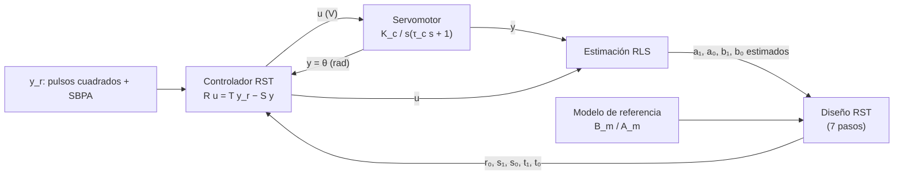
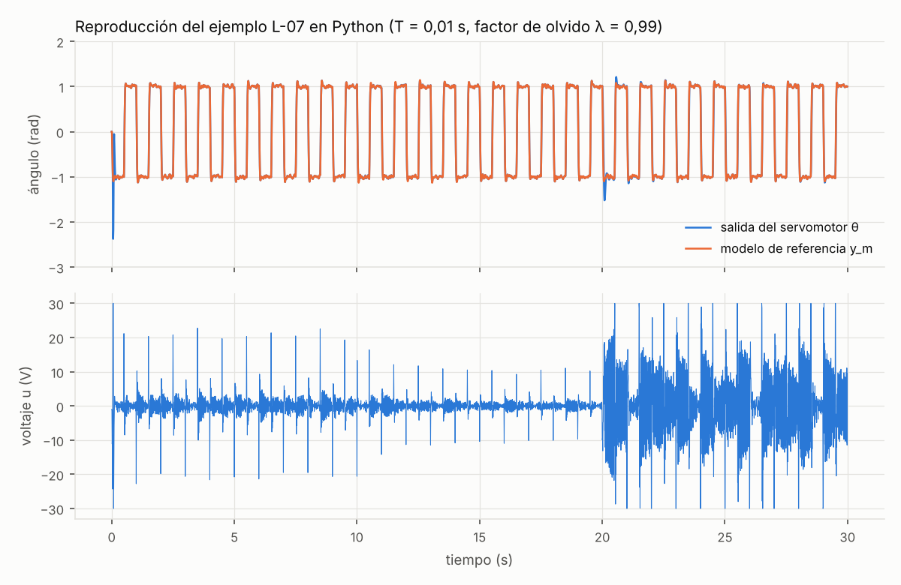
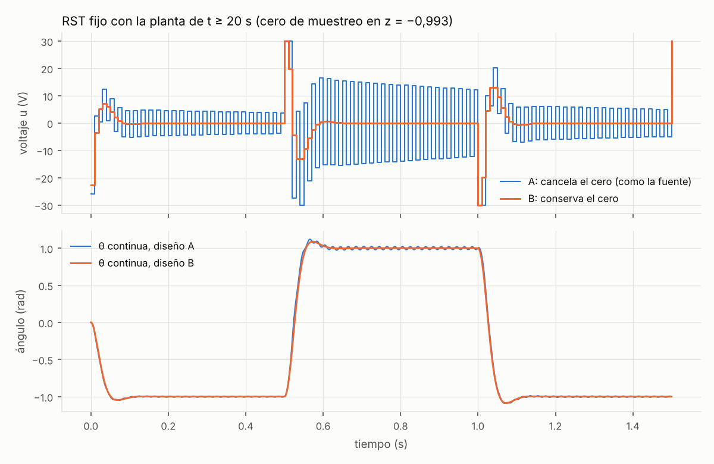

# L-07 · Seguidor de un modelo de referencia: servomotor DC auto-sintonizable (RLS + RST)

> [!NOTE]
> El ejemplo integrador del curso de Control Adaptativo, traído del brain del líder (nota «Servomotor DC self-tuning (RST + RLS)»), contrastado con el PDF original ([L-07](../raw/LINKS.md)) y reproducido en Python con [l-07-servomotor-self-tuning.py](../sim/l-07-servomotor-self-tuning.py). La paráfrasis sigue a la fuente; lo propio va marcado como **interpretación**. Para qué nos sirve: la planta del ejemplo tiene la misma estructura que la de nuestra cámara ([modelo del lazo de rumbo](../Control/modelo-rumbo-espacio-estados.md), modelo reducido).

> [!WARNING]
> **Sin fuente en raw/** — el PDF no se copió a `raw/lecturas/` porque es material de terceros (regla 7); queda congelado por enlace, commit y SHA-256 en `raw/LINKS.md`. **Pendiente:** si el líder lo autoriza, subirlo por `raw/inbox/`.

## 1. Qué resuelve

**C1.** Objetivo, en palabras de la fuente (p. 1): «El diseño permitirá que la posición angular del servomotor siga la dinámica de un modelo de referencia, ante una señal cuadrada de entrada, cuando cambian la ganancia y la constante de tiempo del servomotor.»

Es un regulador auto-sintonizable (self-tuning regulator, STR) con cuatro piezas: un controlador RST, la planta, un estimador de parámetros en línea por mínimos cuadrados recursivos (RLS) y un bloque que rediseña el RST en cada muestreo con los parámetros estimados (equivalencia cierta).



## 2. Fundamentos físicos: la planta

Motor de corriente continua controlado por armadura. Entrada: el voltaje $u$; salida: la posición angular $\theta$.

- **P1. Ley de voltajes de Kirchhoff en la armadura** (ec. 1 de la fuente): $R_a i_a + L_a \dfrac{di_a}{dt} + e_v = u(t)$.
- **P2. Fuerza contraelectromotriz.** Los conductores del rotor que se mueven en el campo del estator inducen un voltaje proporcional a la velocidad: $e_v = k_v\,\dot\theta$.
- **P3. Segunda ley de Newton en el eje** (ec. 3). La fuerza de Lorentz sobre los conductores da un par proporcional a la corriente: $k_t\,i_a - B\,\dot\theta = J\,\ddot\theta$.
- **P4. Conservación de la energía** (complemento de literatura, no está en la fuente). La potencia eléctrica convertida, $e_v i_a = k_v\dot\theta\, i_a$, es la mecánica, $k_t i_a\,\dot\theta$; por eso en unidades SI $k_t = k_v$ (N·m/A = V·s/rad).

Con Laplace, P3 da $I_a = (Js^2+Bs)\,\Theta/k_t$; al reemplazarlo en P1 y P2 se obtiene la ec. (4):

$$
\frac{\Theta(s)}{U(s)}=\frac{k_t}{s\left[(Js+B)(R_a+L_a s)+k_v k_t\right]}
$$

**S1 de la fuente.** La dinámica eléctrica es más rápida que la mecánica, así que $L_a \approx 0$ (ecs. 5 a 8):

$$
\frac{\Theta(s)}{U(s)}=\frac{K_c}{s(\tau_c s+1)},\qquad
\tau_c=\frac{J R_a}{B R_a+k_v k_t},\qquad
K_c=\frac{k_t}{B R_a+k_v k_t}
$$

$K_c$ es la velocidad final por voltio (rad/s por V) y $\tau_c$, la constante de tiempo electromecánica. Son los dos parámetros que se suponen cambiantes: temperatura, desgaste, carga.

**Espacio de estados.** El diagrama de Simulink de la fuente (figura 3) implementa exactamente esto, con $x=[\theta,\ \omega]^T$:

$$
A=\begin{bmatrix}0&1\\0&-\dfrac{1}{\tau_c}\end{bmatrix},\qquad
B=\begin{bmatrix}0\\ \dfrac{K_c}{\tau_c}\end{bmatrix},\qquad
C=\begin{bmatrix}1&0\end{bmatrix},\qquad D=0
$$

## 3. Discretización (T = 0,01 s)

Con retenedor de orden cero (ZOH) y $p=e^{-T/\tau_c}$, la planta queda (deducción y comprobación simbólica en el [modelo del lazo de rumbo](../Control/modelo-rumbo-espacio-estados.md), §5):

$$
\frac{B(z)}{A(z)}=\frac{b_{1D}z+b_{0D}}{z^2+a_{1D}z+a_{0D}},\qquad a_{1D}=-(1+p),\quad a_{0D}=p,\quad b_{1D}=K_c\big(T-\tau_c(1-p)\big),\quad b_{0D}=K_c\big(\tau_c(1-p)-Tp\big)
$$

Los tres regímenes de la simulación de la fuente, recalculados ([CSV](../derivados/l-07-modelos-discretos.csv)):

| Régimen | $K_c$ | $\tau_c$ | $a_{1D}$ | $a_{0D}$ | $b_{1D}$ | $b_{0D}$ | cero $z_0=-b_{0D}/b_{1D}$ | ¿Coincide con la fuente? |
|---|---|---|---|---|---|---|---|---|
| 0 < t < 10 s | 30 | 0,1 s | −1,9048 | 0,9048 | 0,0145 | 0,014 | −0,9672 | sí: ec. (17) y tabla 1 |
| 10 ≤ t < 20 s | 60 | 0,1 s | −1,9048 | 0,9048 | 0,029 | 0,0281 | −0,9672 | sí: ec. (18) y tabla 1 |
| t ≥ 20 s | 60 | 0,5 s | −1,9802 | 0,9802 | 0,006 | 0,0059 | −0,9934 | con la tabla 1 sí; con la ec. (19), no |

> [!CAUTION]
> **Erratas de la fuente.** (1) La ec. (19) (p. 9), modelo para t ≥ 20 s, repite los números de la ec. (17); los correctos son los de la tabla 1 (p. 10), y el script los confirma. (2) En la p. 8, el primer intervalo dice «0<t<100», cuando es 0 < t < 10 s.

## 4. Estimación en línea: mínimos cuadrados recursivos

**El modelo, lineal en los parámetros** (forma ARX). Se multiplica en cruz, $A(z)Y(z)=B(z)U(z)$; se lee $z$ como adelanto de una muestra; se corre el índice dos pasos y se despeja $y(k)$:

$$
y(k)=-a_{1D}\,y(k-1)-a_{0D}\,y(k-2)+b_{1D}\,u(k-1)+b_{0D}\,u(k-2)=\varphi^T(k)\,\theta
$$

$$
\varphi^T(k)=\big[-y(k-1),\ -y(k-2),\ u(k-1),\ u(k-2)\big],\qquad \theta=\big[a_{1D},\ a_{0D},\ b_{1D},\ b_{0D}\big]^T
$$

Los valores pasados de $y$ entran con signo menos (salen de despejar los $a$) y los de $u$, con signo más. No aparece $u(k)$ porque el grado relativo es 1.

**El algoritmo** (Plackett, ecs. 9 a 13): estimación anterior más una corrección proporcional al error de predicción.

$$
K(t)=\frac{P(t-1)\varphi(t)}{1+\varphi^T(t)P(t-1)\varphi(t)},\qquad
\hat\theta(t)=\hat\theta(t-1)+K(t)\big[y(t)-\varphi^T(t)\hat\theta(t-1)\big],\qquad
P(t)=\big[I-K(t)\varphi^T(t)\big]P(t-1)
$$

$P$ mide cuánta incertidumbre queda. **Las ecuaciones de la fuente no tienen factor de olvido**, así que $P$ solo decrece (ver §7).

## 5. Diseño RST: por qué y cómo

**Por qué no basta un controlador en serie.** Con $G_cG_p$ en lazo cerrado, la diofántica fija el denominador, pero el numerador queda amarrado a $N_cN_p$. El RST separa el camino de la referencia del de la realimentación, $R\,U=T\,Y_r-S\,Y$, y entonces

$$
\frac{Y}{Y_r}=\frac{BT}{AR+BS},\qquad \frac{U}{Y_r}=\frac{AT}{AR+BS}
$$

$R$ y $S$ ubican los polos; $T$, libre, ajusta el numerador.

**Los 7 pasos, como los aplica la fuente** (modelo de referencia $G_m(s)=\omega_n^2/(s^2+2\xi\omega_n s+\omega_n^2)$, discretizado a $B_m/A_m=(b_{1mD}z+b_{0mD})/(z^2+a_{1mD}z+a_{0mD})$):

1. $A$ y $B$ coprimos, $A$ mónico, $\operatorname{grad}A \ge \operatorname{grad}B$: se cumple.
2. $B=B^+B^-$ con $B^+=z+b_{0D}/b_{1D}$ (el cero, que la fuente trata como cancelable) y $B^-=b_{1D}$.
3. Grado relativo del modelo ≥ el de la planta: $2-1 \ge 2-1$.
4. $\operatorname{grad}R=\operatorname{grad}A-1=1$: $R=z+r_0$, $S=s_1z+s_0$, $T=t_1z+t_0$.
5. Diofántica reducida $AR_1+B^-S=A_oA_m$, con $\operatorname{grad}A_o \ge 2\cdot2-2-1-1=0$, así que $A_o=1$ y $R_1=1$. Igualando coeficientes:

$$
r_0=\frac{b_{0D}}{b_{1D}},\qquad s_1=\frac{a_{1mD}-a_{1D}}{b_{1D}},\qquad s_0=\frac{a_{0mD}-a_{0D}}{b_{1D}}
$$

6. $T=A_oB_m'$ con $B_m'=B_m/B^-$: $\;t_1=b_{1mD}/b_{1D}$, $\;t_0=b_{0mD}/b_{1D}$.
7. Se simula y se compara contra el modelo.

**Comprobación.** Con $R=B^+$: $AR+BS=B^+(A+B^-S)=B^+A_m$ y $Y/Y_r=B^+B^-B_m'/(B^+A_m)=B_m/A_m$. **Ley implementable** (lo que corre el microcontrolador en cada muestreo):

$$
u(k)=-r_0\,u(k-1)+t_1\,y_r(k)+t_0\,y_r(k-1)-s_1\,y(k)-s_0\,y(k-1)
$$

Todos los coeficientes dividen por $\hat b_{1D}$: si la estimación pasa cerca de cero, el controlador explota.

## 6. Escenario y resultados de la fuente

- **M1.** Referencia: tren de pulsos cuadrados más una señal binaria pseudoaleatoria (SBPA) de 8 registros, para tener excitación persistente. Actuador limitado a ±30 V. Parámetros iniciales en cero.
- **M2.** Tabla 1 (p. 10): los estimados coinciden con los reales hasta la tercera o cuarta decimal en los tres regímenes.
- **M3.** Figuras 6 a 9 (pp. 11 y 12): tras un transitorio inicial de unos −6 rad, la salida sigue al modelo a los ≈ 0,2 s; en t = 20 s hay oscilaciones que se apagan en pocos ciclos.
- **M4.** Figura 10 y conclusión (p. 13): «se requiere en este caso un actuador electrónico que permita un suicheo rápido en el voltaje de alimentación del servomotor. La fuente deberá tener la posibilidad de suministrar +30 V y -30V».

## 7. Reproducción en Python

[l-07-servomotor-self-tuning.py](../sim/l-07-servomotor-self-tuning.py) simula la planta continua con ZOH exacto, el RLS y el diseño RST en línea. Supuestos para lo que la fuente no da:

- **S1.** Modelo de referencia con ξ = 0,7 y $\omega_n$ = 65 rad/s, leídos a ojo de la figura 7 (sobrepaso de ≈ 5 % y pico a ≈ 0,07 s del escalón).
- **S2.** SBPA de 0,05 rad, un bit por muestra.
- **S3.** $P(0)=1000\,I$.
- **S4.** Mientras $|\hat b_{1D}|<10^{-3}$, se aplica $u=y_r$.
- **S5.** La recursión del RST usa el voltaje ya saturado.

Resultado al final de cada régimen ([CSV](../derivados/l-07-reproduccion-str.csv)):

| Factor de olvido λ | Diferencia máxima con la tabla 1 (0–10 / 10–20 / ≥ 20 s) | Error rms de seguimiento (mismos tramos) |
|---|---|---|
| 1 (ecuaciones de la fuente) | 0,0003 / 0,0199 / 0,0793 | 0,0001 / 0,0727 / 0,1829 rad |
| 0,995 | 0,0002 / 0,0006 / 0,0008 | 0,0000 / 0,0168 / 0,0612 rad |
| 0,99 | 0,0002 / 0,0002 / 0,0002 | 0,0000 / 0,0037 / 0,0597 rad |

- **M5.** Con las ecuaciones tal como están impresas (λ = 1), el primer régimen coincide con la tabla 1, pero el estimador **no se readapta** en los 10 s siguientes a cada cambio: $b_{1D}$ llega a 0,018 en vez de 0,029, y a 0,0107 en vez de 0,0059.
- **M6.** Con λ = 0,99 la reproducción coincide con la tabla 1 (diferencia máxima 0,0002) y reproduce el ensanchamiento del voltaje después de t = 20 s (rms de Δu 21,8 V, 3,7 % de muestras saturadas), como la figura 10.
- **Interpretación.** El resultado de la fuente necesita algo que el texto no describe: un factor de olvido, un reinicio de $P$ u otro mecanismo. Es la «pieza que le falta al RLS puro» de la nota «Factor de olvido (RLS)» del brain de Control Adaptativo.
- El transitorio inicial llega a −2,38 rad, no a ≈ −6 rad, porque depende de cómo se arranque (S4), y la fuente no lo dice.



## 8. Lectura crítica: el cero de muestreo que se cancela

> [!IMPORTANT]
> **Interpretación propia, verificada con el script.** El paso 2 cancela el cero $z_0=-b_{0D}/b_{1D}$, que está en −0,967 y, después de t = 20 s, en −0,993. Es estable, pero está sobre el eje real negativo y pegado a −1: **mal amortiguado**. La misma fuente define $B^-$ como «ceros inestables y mal amortiguados», y el ejemplo del doble integrador del curso declara no cancelable el cero en −1.

**Por qué importa.** Con $R=B^+$, el voltaje es

$$
\frac{U}{Y_r}=\frac{A\,T}{B^+A_m}
$$

y $B^+$ en el denominador mete el modo $(z_0)^k$: **el voltaje cambia de signo en cada muestra** y se apaga en ≈ $3\tau_c$ (0,3 s con $\tau_c$ = 0,1 s y 1,5 s con 0,5 s). La salida muestreada sigue al modelo, pero el motor recibe un zumbido continuo.

**Comparación con los parámetros verdaderos** (RST fijo, sin adaptación, ±30 V). Diseño A: el de la fuente, que cancela el cero. Diseño B: lo conserva, con $B^+=1$, $B^-=b_{1D}z+b_{0D}$, $B_m=K_mB^-$ (ganancia unitaria en estado estacionario) y $A_o=z$. Ventanas de reposo: los últimos 0,2 s antes de cada escalón ([CSV](../derivados/l-07-cero-de-muestreo.csv)):

| Planta | Modelo | rms de Δu en reposo, A / B | Oscilación de θ en reposo, A / B | u máximo, A / B |
|---|---|---|---|---|
| $K_c$ = 30, $\tau_c$ = 0,1 s | $\omega_n$ = 65 rad/s | 1,82 / 0 V | 9,26 / 0,003 mrad | 20,9 / 18,8 V |
| $K_c$ = 60, $\tau_c$ = 0,1 s | $\omega_n$ = 65 rad/s | 0,91 / 0 V | 9,26 / 0,003 mrad | 10,5 / 9,4 V |
| $K_c$ = 60, $\tau_c$ = 0,5 s | $\omega_n$ = 65 rad/s | 18,24 / 0 V | 41,52 / 0,004 mrad | 30 / 30 V (satura) |
| $K_c$ = 60, $\tau_c$ = 0,5 s | $\omega_n$ = 40 rad/s | 2,19 / 0,001 V | 3,88 / 0,24 mrad | 21,3 / 20,4 V |
| $K_c$ = 60, $\tau_c$ = 0,5 s | $\omega_n$ = 90 rad/s | 8,08 / 0 V | 18,35 / 0 mrad | 30 / 30 V (satura) |

- **M7.** El diseño A zumba en todos los casos y el B en ninguno. El efecto crece cuando el cero se acerca a −1 y cuando el modelo de referencia es agresivo y el actuador satura: en el régimen de t ≥ 20 s, la salida oscila 41,5 mrad (2,4°) pico a pico estando «quieta».
- **Interpretación.** Esto explica la banda gruesa de la figura 10 después de t = 20 s, cuando el cero pasa a −0,993.
- **El precio del diseño B.** El cero queda en el lazo cerrado y la salida sigue a $K_mB^-/A_m$, un modelo casi igual al pedido pero no idéntico. Hay que aceptarlo: ese cero no se puede quitar sin pagar con el zumbido.



## 9. Qué nos llevamos para el lazo de la cámara

| En el ejemplo | En nuestro lazo de rumbo |
|---|---|
| $\theta$, posición del eje, medida directamente | $\psi_c=\psi_b+\theta_g$: rumbo de la cámara, **estimado** con giróscopo, magnetómetro y, si se puede, codificador |
| $u$: voltaje de armadura, ±30 V | $u$: voltaje (PWM) del motor del servo, limitado por la batería |
| referencia: pulsos de ±1 rad | referencia: el norte (C8) y un escalón de 90° por comando a los 30 s (C11) |
| $K_c$ y $\tau_c$ cambian | $J_c$, la fricción, el voltaje de la batería y la temperatura cambian (la prueba térmica es a 60 °C, M10) |
| T = 0,01 s | T = 0,01 s (lazo a 100 Hz) |
| sin perturbación | el giro del cuerpo bajo el paracaídas se suma a la salida |
| SBPA para excitación persistente | excitar hace rotar el video: choca con C8 |

1. **Misma planta, mismas herramientas.** $K_c/(s(\tau_c s+1))$, en espacio de estados y en $z$.
2. **No cancelar el cero de muestreo.** A 100 Hz, si $\tau_c$ está entre 0,05 y 1 s, el cero queda entre −0,94 y −0,997. Se usa el diseño B.
3. **El hardware limita el modelo de referencia.** El ejemplo necesita ±30 V; nosotros tendremos mucho menos, así que el modelo de referencia tiene que ser más lento. La guía no dice qué tan rápido debe ser el giro de 90° (C11): es un parámetro de diseño (futuro DEC).
4. **Excitación persistente frente a C8.** La SBPA del ejemplo haría rotar la imagen, y la cámara graba desde que el PocketQube se enciende (PQ16). Opciones (futuro DEC): identificar en tierra y volar con un RST fijo o con ganancias programadas, o excitar con una amplitud que quepa en los ±10°.
5. **Factor de olvido.** Si se adapta en vuelo, el RLS lo necesita (§7).
6. **Acción integral.** El RST del ejemplo no tiene integrador: con un giro constante del cuerpo queda un error final que crece si el modelo de referencia es lento ([modelo del lazo de rumbo](../Control/modelo-rumbo-espacio-estados.md), §6). Hace falta $R$ con el factor $(z-1)$ o compensar con el giróscopo.

> [!WARNING]
> **Sin fuente en raw/** — el voltaje que podrá dar la batería depende de cómo se conecten las celdas 18650 de la base «Hardware», y eso está **Pendiente**. Una celda de ion de litio ronda los 3,7 V nominales (dato general, no de una hoja de datos del equipo).

## Cómo se reproduce

```bash
python3 sim/l-07-servomotor-self-tuning.py   # 3 CSV en derivados/ y 2 figuras en salida/figuras/
```
