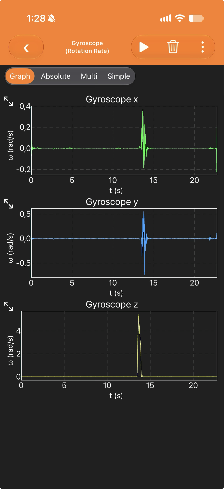
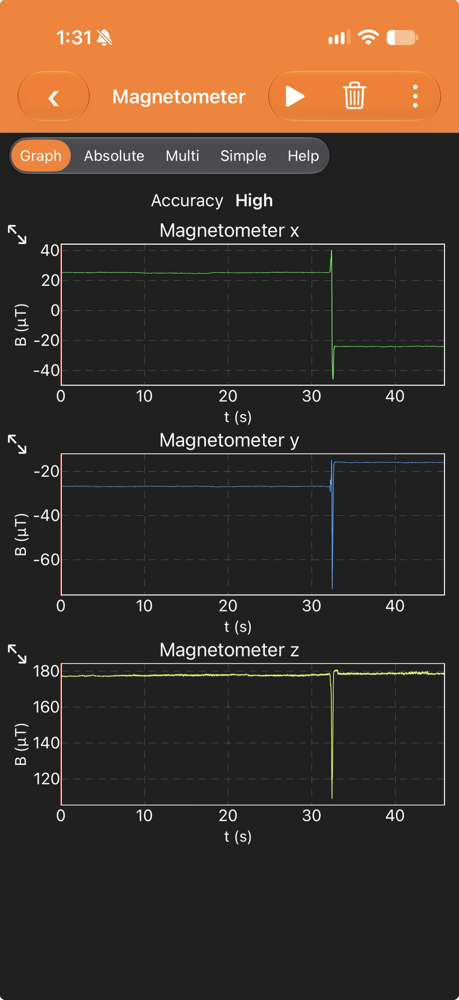

# Giróscopo y magnetómetro: qué miden y por qué los necesitamos

> [!NOTE]
> Nota de aprendizaje, construida paso a paso con el líder de control a partir de la pregunta «¿qué necesito saber de la caja, en cada instante, para que el suelo no rote en el video?». Los experimentos están en [TST-001](../Pruebas/tst-001-exploracion-sensores-celular.md).

**El problema en una frase:** para que el suelo no rote más de ±10° en el video (C8, p. 9) y la vista gire 90° por comando (C11, p. 9; PQ17 y PQ18, p. 14), hay que conocer en todo momento el **rumbo** (heading) de la cámara: hacia dónde mira, en grados desde el norte.

## 1. Cómo funcionan

### Giróscopo (gyroscope)

- **D1.** Mide la **velocidad angular** ω, es decir, qué tan rápido gira algo, en rad/s o en °/s, en tres ejes. 1 rad/s ≈ 57,3 °/s.
- **D2.** No mide el ángulo. Para obtenerlo hay que **integrar** (ir sumando) la velocidad desde un ángulo inicial θ₀ que el giróscopo no conoce:

$$
\theta(t) = \theta_0 + \int_0^t \omega\,d\tau
$$

- **P1.** Un error constante del sensor (sesgo, bias) b crece con el tiempo al integrarlo:

$$
\Delta\theta(t) = b\,t
$$

  Por ejemplo, 0,01 rad/s durante los 120 s del descenso dan 1,2 rad, unos 69° (cálculo ilustrativo).
- **Ventajas:** responde rápido y no le afectan los imanes. **Desventajas:** deriva con el tiempo y no sabe dónde está el norte.
- **En el experimento:** el giróscopo solo «habla» mientras hay giro (TST-001·M1) y en reposo queda en ≈ 0 con un ruido de ≈ ±0,003 rad/s (TST-001·M2).

### Magnetómetro (magnetometer)

- **D3.** Mide el **campo magnético** B en tres ejes, en µT. La guía lo pide en miligauss: 1 G = 100 µT y 1 mG = 0,1 µT.
- **D4.** El campo de la Tierra apunta hacia el norte magnético y, en el hemisferio norte, también hacia abajo. Con el sensor nivelado y los ejes de la guía (X este, Y sur, Z nadir, p. 25), el rumbo magnético sale de las dos componentes horizontales. El rumbo verdadero se obtiene sumando la declinación D:

$$
\psi_m = \operatorname{atan2}(-B_x,\,-B_y),\qquad \psi = \psi_m + D
$$

  Esta fórmula es una derivación propia; si el sensor está inclinado, primero hay que «enderezar» la medida con la inclinación (siguiente paso: el acelerómetro).
- **Ventajas:** da una referencia **absoluta** (el norte). **Desventajas:** mide **todos** los campos cercanos: el del propio aparato (hierro duro y blando, hard iron y soft iron), motores, servos, la carcasa de acero de la batería y el edificio.
- **En el experimento:** los valores cambian con la orientación y se quedan en el valor nuevo (TST-001·M3). También aparecieron un campo que gira con el celular (TST-001·A1) y lecturas muy distintas según el entorno (TST-001·A2).

### Por qué necesitamos los dos

| | Giróscopo | Magnetómetro |
|---|---|---|
| Qué mide | velocidad de giro | dirección del campo magnético |
| Unidad | rad/s o °/s | µT o mG |
| ¿Sabe dónde está el norte? | no | sí |
| Rapidez | alta, sin retardo | menor; hay que filtrar el ruido |
| Lo que lo engaña | su sesgo, que se acumula al integrar | imanes, motores, batería, metales |
| Papel en el lazo | movimientos rápidos (lazo interno) | referencia absoluta (lazo externo) |

- **S1.** El PocketQube va apagado dentro del contenedor y se enciende al soltarse, en el aire (PQ21, p. 14). Al encenderse, el giróscopo no sabe hacia dónde está el norte; solo el magnetómetro puede decirlo. A corto plazo, en cambio, el giróscopo es más confiable.
- **Siguiente paso:** combinar los dos (fusión de sensores).

### Sensores elegidos por el equipo

Según la base «Hardware» de Notion (copia en [notion-hardware-2026-10-25.md](../raw/datos/notion-hardware-2026-10-25.md)):

- **BNO055** (IMU, seleccionado): «9 ejes con fusión interna a 100 Hz», y advierte: «su magnetómetro interno sufrirá con un actuador cercano».
- **LIS3MDL** (magnetómetro del brazo, seleccionado): «0.146 mG por LSB en ±4 G: cumple PQ30», y «En la punta del boom queda lejos del ruido magnético de servos y batería».
- **Turbowing Cyclops 3 V3** (cámara, seleccionada): «El video no pasa por el MCU, así que la estabilización (C8) y el giro de 90° (C11) deben ser mecánicos.»

> [!WARNING]
> **Sin fuente en raw/** — Según la página del producto de ST ([L-05](../raw/LINKS.md), vista solo en un resumen del buscador), el LIS3MDL figura como NRND (no recomendado para diseños nuevos) u obsoleto, con el LIS2MDL como reemplazo. **Pendiente:** confirmar su disponibilidad antes del PDR.

## 2. Bogotá, Medellín y Virginia

Valores del modelo magnético mundial WMM2025 ([L-01](../raw/LINKS.md)), calculados con [campo-geomagnetico.py](../sim/campo-geomagnetico.py) y guardados en [campo-geomagnetico.csv](../derivados/campo-geomagnetico.csv). Las coordenadas son el centro de cada ciudad (supuesto).

| Sitio | Fecha | Campo total | Horizontal | Vertical | Inclinación I | Declinación D | tan I | Error de rumbo por 1° de inclinación | Perturbación que causa 1° de rumbo |
|---|---|---|---|---|---|---|---|---|---|
| Bogotá | 2026-10-25 | 29,9 µT | 26,8 µT | 13,3 µT | 26,5° | −8,8° | 0,50 | 0,50° | 4,7 mG |
| Medellín | 2026-10-25 | 30,8 µT | 26,9 µT | 15,1 µT | 29,3° | −8,0° | 0,56 | 0,56° | 4,7 mG |
| Monterey, Virginia | 2027-06-12 | 50,2 µT | 21,4 µT | 45,4 µT | 64,7° | −9,2° | 2,12 | 2,12° | 3,7 mG |

> [!WARNING]
> **Sin fuente en raw/** — El sitio de lanzamiento (Monterey, Virginia) viene de un anuncio de West Virginia Space Grant ([L-03](../raw/LINKS.md)) que no se pudo abrir; la guía no lo dice. Hay que confirmarlo con la organización.

Qué cambia entre los sitios:

1. **En Colombia el campo es casi horizontal; en Virginia, casi vertical.** La inclinación es de unos 27–29° en Colombia frente a 65° en Virginia.
2. **En Virginia, la «señal del norte» es más débil.** La componente horizontal baja de ≈ 27 µT a ≈ 21 µT, así que la misma perturbación magnética produce más error de rumbo: basta 3,7 mG para 1°, frente a 4,7 mG en Colombia.
3. **Un error de inclinación pesa unas 4 veces más en Virginia.** El error de rumbo crece con tan I: 0,50 en Bogotá frente a 2,12 en Virginia. Una prueba que sale bien en Bogotá o en Medellín **no garantiza** lo mismo en Virginia; hay que simular o corregir ese factor.
4. **La declinación se parece** (entre −8° y −9°), pero en vuelo se usa la de Virginia: −9,2°.
5. **El giróscopo casi no cambia entre sitios.** La rotación de la Tierra (7,3 × 10⁻⁵ rad/s, ≈ 0,004 °/s) queda muy por debajo del ruido observado (≈ ±0,17 °/s, TST-001·M2). Lo que sí lo afecta es la temperatura (la prueba térmica es a 60 °C, M10).

## 3. Las leyes físicas y lo que pide la guía

### Giróscopo MEMS: efecto Coriolis

- **P2.** Dentro del chip, una masa diminuta vibra con velocidad $\vec v$. Si el chip gira con velocidad angular $\vec\Omega$, aparece la fuerza de Coriolis, perpendicular a la vibración y proporcional al giro. El chip la detecta como un cambio de capacitancia ([L-04](../raw/LINKS.md)):

$$
\vec F_C = -2\,m\,\vec\Omega \times \vec v
$$

  Es la misma fuerza que desvía una pelota lanzada sobre un carrusel.
- **P3.** Lo que entrega es Ω, una velocidad. El ángulo exige integrar (D2), y por eso aparece la deriva (P1).

### Magnetómetro: el campo de la Tierra y cómo se mide

- **P4.** En cada lugar, el campo de la Tierra se describe con su intensidad total F, la inclinación I y la declinación D (modelo WMM, [L-01](../raw/LINKS.md)):

$$
H = F\cos I,\qquad Z = F\sin I,\qquad \tan I = \frac{Z}{H}
$$

- **P5.** Principios de medición más comunes. Cuál usa cada chip es **Pendiente** de confirmar en su hoja de datos.
  - **Efecto Hall:** la fuerza de Lorentz desvía las cargas que circulan por una lámina de espesor t y aparece un voltaje transversal:

$$
\vec F = q\,\vec v \times \vec B,\qquad V_H = \frac{I\,B}{n\,q\,t}
$$

  - **Magnetorresistencia anisótropa:** la resistencia de ciertos materiales cambia con el ángulo θ entre la corriente y la magnetización, $R(\theta) = R_0 + \Delta R\,\cos^2\theta$.
  - **Fluxgate:** un núcleo se satura de forma alternada y el campo externo descompensa esa saturación; se mide por inducción (ley de Faraday, $\varepsilon = -\,d\Phi_B/dt$).
- **P6.** Un imán cercano se comporta como un dipolo y su campo cae con la distancia al cubo:

$$
B \propto \frac{1}{r^3}
$$

  Llevar el magnetómetro de 3 cm a 22 cm reduce esa interferencia unas 400 veces. Por eso la guía lo pone en la punta de un brazo.
- **P7.** Si la inclinación estimada tiene un error δ sobre el eje norte–sur, la componente vertical del campo «se filtra» en el rumbo:

$$
\Delta\psi \approx \arctan\big(\tan I\,\sin\delta\big)
$$

### Lo que pide la guía (texto oficial)

| ID | Texto oficial | Página | Qué implica |
|---|---|---|---|
| PQ28 | «The PocketQube shall measure the rotation rate in the X,Y,Z axis in degrees/sec to 0.1 degree/sec resolution.» | p. 15 | giróscopo de 3 ejes, reportado en °/s con resolución de 0,1 °/s |
| PQ30 | «The PocketQube shall measure earth’s magnetic field in the X,Y,Z axis in milli Gauss to 1 milli Gauss resolution.» | p. 15 | magnetómetro de 3 ejes, en mG con resolución de 1 mG |
| Telemetría | «Calibrated magnetometer values in milliGauss at 1 mGauss (Requirement PQ30)» | p. 26 | los valores deben ir **calibrados** |
| PQ9 | «The PocketQube shall include a boom with a magnetometer mounted on the end.» | p. 13 | magnetómetro en la punta del brazo |
| PQ10 | «The boom shall extend 220 mm from the nadir edge of the PocketQube when commanded by the ground station.» | pp. 13–14 | 220 mm de distancia: menos interferencia (P6) |
| Ejes | «The following satellite industry standard definition of the Roll, Pitch, and Yaw axes shall be used for telemetry data and must be considered when mounting and aligning inertial measurement units.» | p. 25 | los ejes del IMU y del magnetómetro se montan alineados con X (este), Y (sur) y Z (nadir) |
| PQ21 | «The PocketQube shall be powered off while in the container.» | p. 14 | no se puede calibrar el sesgo en tierra justo antes del vuelo (S1) |
| C8 | «The PocketQube shall record video in the nadir direction with less than +/- 10 degrees rotation in the video.» | p. 9 | error de rumbo de la imagen < 10° |
| C11 | «The PocketQube shall rotate the video along the nadir axis at the specified angle on command.» | p. 9 | giro controlado por comando |
| PQ15 | «The video of the ground shall be stabilized so the ground does not rotate during the flight.» | p. 14 | estabilizar todo el vuelo |
| PQ17 | «The video camera orientation shall be controlled by an uplink command.» | p. 14 | orientación de la cámara controlada desde tierra |
| PQ18 | «The camera orientation command shall control the angle change in degrees.» | p. 14 | el comando lleva el ángulo en grados |

Además, la estación terrena debe graficar la orientación del PocketQube en tres ejes a partir de los sensores (GS4, p. 18).

## Preguntas para el siguiente paso

1. Cuando el PocketQube se balancea bajo el paracaídas, ¿cómo sabe hacia dónde es «abajo»? Pista: el acelerómetro.
2. ¿Cómo se combinan un sensor rápido que deriva y uno lento que no deriva? Pista: el filtro complementario.
