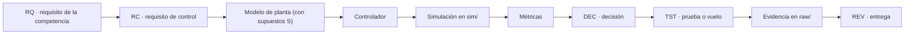
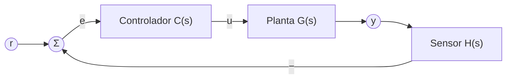

# Alcance del frente de control

**Líder del frente:** Angel Fernando Revelo Narvaez.

> [!IMPORTANT]
> Esta nota todavía no tiene fuentes en `raw/`. Se completará con la guía de misión y las notas del líder de control. Nada de lo que sigue es un requisito ni una decisión: son definiciones de trabajo y preguntas abiertas.

## Lo que sabemos

- **D1.** El brain cubre la misión completa a nivel de resumen y el frente de control a fondo.
- **D2.** El frente de control lo lidera Angel Fernando Revelo Narvaez.

## Pendientes

> [!WARNING]
> **Pendiente** — Nombre y edición de la competencia.

> [!WARNING]
> **Pendiente** — Integrantes del equipo y frente de cada uno.

> [!WARNING]
> **Pendiente** — Qué abarca «control» en nuestra misión (fases, magnitudes que se controlan, sensores y actuadores).

> [!WARNING]
> **Pendiente** — Fechas de las revisiones (PDR, CDR, PFR u otras que fije la guía) y del lanzamiento.

> [!WARNING]
> **Pendiente** — Si el repositorio es solo del líder de control o de todo el equipo.

## Preguntas que la guía de misión debe responder

Son preguntas para orientar la lectura de la guía, no supuestos.

1. ¿Qué requisitos restringen la fase de descenso (velocidad, estabilidad, orientación, zona de aterrizaje)?
2. ¿Hay mecanismos que se activen o liberen durante el vuelo, y con qué condición (altura, tiempo, evento)?
3. ¿Se exige guiado hacia un punto (guidance) o control de actitud (attitude control)?
4. ¿Qué telemetría exige la competencia y con qué frecuencia? Esto limita la estimación de estado (state estimation).
5. ¿Qué límites de masa, energía, volumen o tipo de actuador afectan al control?
6. ¿Se exige una máquina de estados (state machine) del software de vuelo, modos de operación o recuperación tras un reinicio?

## Cómo se trabaja el control en este brain

Cada diseño sigue la skill `control` y queda trazado de punta a punta:

Lazo de realimentación (feedback loop) genérico con el que se describen los diseños:

## Métricas de desempeño (definiciones de trabajo)

Cuando un RC fije otro criterio, manda el RC.

- **D3.** Sobrepaso máximo (overshoot), con $y_\infty$ el valor final:

$$
M_p = \frac{y_{\max} - y_\infty}{y_\infty} \times 100\ \%
$$

- **D4.** Tiempo de establecimiento (settling time) $t_s$: el primer instante a partir del cual $|y(t) - y_\infty| \le 0{,}02\,|y_\infty|$ (criterio del 2 %).
- **D5.** Error en estado estacionario (steady-state error):

$$
e_{ss} = \lim_{t \to \infty} \big( r(t) - y(t) \big)
$$

- **D6.** Margen de ganancia (gain margin) en dB y margen de fase (phase margin) en grados, medidos sobre la función de lazo abierto $L(s) = C(s)\,G(s)\,H(s)$.
- **D7.** Esfuerzo de control: valor máximo de $|u(t)|$ frente al límite de saturación del actuador, tomado de su hoja de datos (DS).

## Notas del frente

Los requisitos de control (RC-NNN) y los diseños se listan en el [README de Control](README.md).
