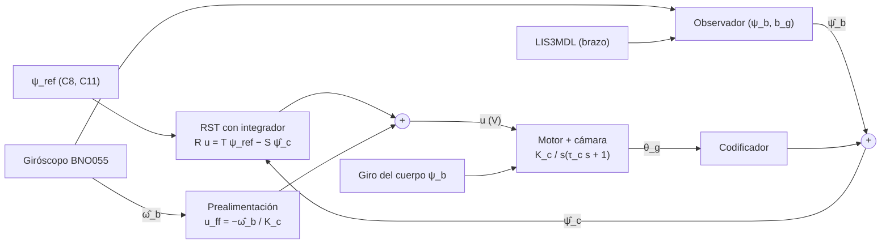
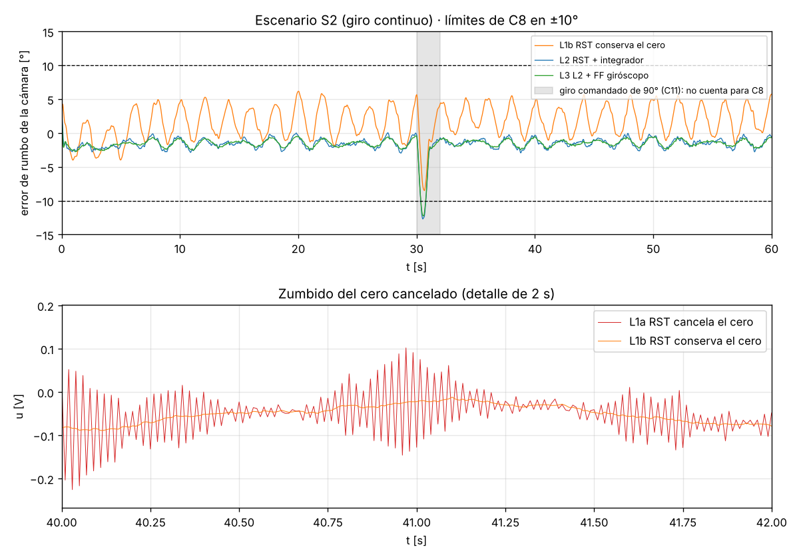
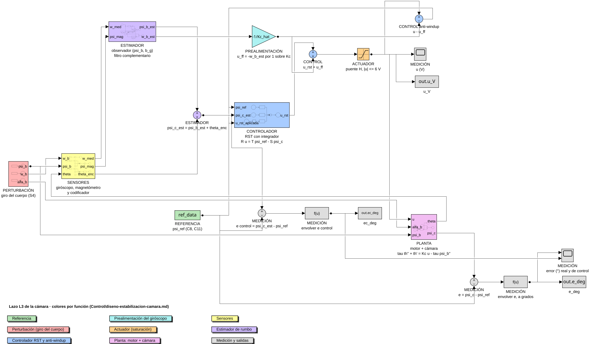
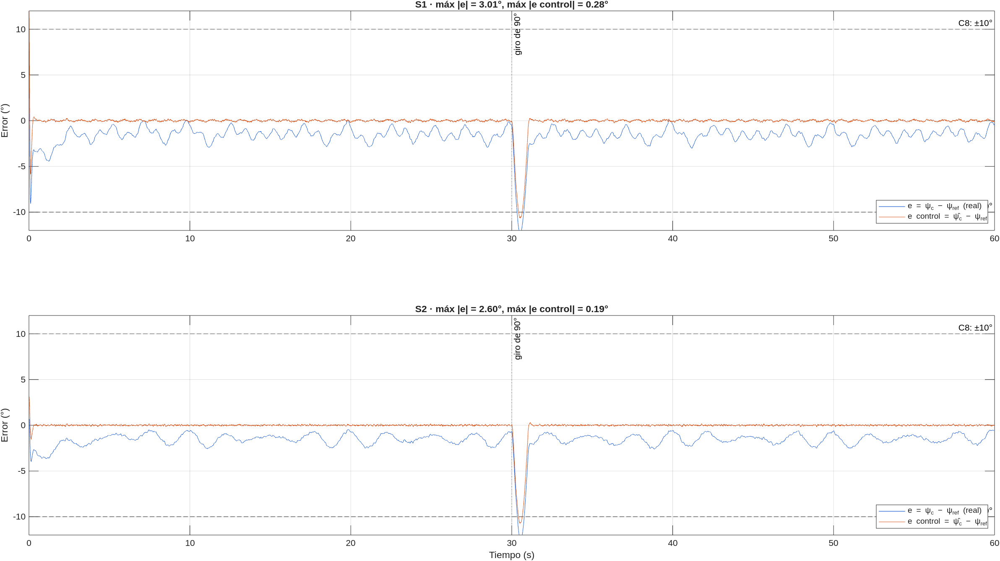

# Diseño del lazo de estabilización de la cámara: opciones de control

> [!NOTE]
> Continúa el [modelo del lazo de rumbo](modelo-rumbo-espacio-estados.md) y su "siguiente paso": diseñar el RST que conserva el cero de muestreo, con acción integral. Compara 9 leyes de control (L0 a L8) y simula 6 de ellas (L0 a L5) en [diseno-estabilizacion-camara.py](../sim/diseno-estabilizacion-camara.py). Todos los números de esta nota salen de ese script.
> Nace de una consulta del líder de control (sesión del 2026-11-08) sobre qué controladores sirven con el BNO055. Hay una versión con derivaciones extendidas en el brain de Control Adaptativo ([Estabilización de cámara (CanSat) — opciones de control](https://github.com/fernadoR212002/Brain-Adaptative-Control/blob/main/Wiki/Comparativas/Estabilizaci%C3%B3n%20de%20c%C3%A1mara%20(CanSat)%20%E2%80%94%20opciones%20de%20control.md)).

> [!WARNING]
> **Pendiente** — Todavía no hay RC del lazo de rumbo (falta correr la skill `requisitos`), así que `requisitos` está vacío. La nota se traza a mano a los requisitos de la guía C8 y C11 (p. 9) y PQ15, PQ17 y PQ18 (p. 14). Tampoco hay ningún parámetro medido: la planta es la del ejemplo [L-07](../Conceptos/l-07-servomotor-self-tuning.md).

## 1. Especificación

- **C1.** C8 (p. 9): video al nadir con menos de ±10° de rotación. Interpretación, igual que en el modelo: $\lvert\psi_c-\psi_{ref}\rvert<10°$ fuera de los giros comandados.
- **C2.** C11 (p. 9), PQ17 y PQ18 (p. 14): girar la vista el ángulo pedido en grados. Se simula un giro de 90° a los 30 s, suavizado en 1 s.
- **C3.** PQ15 (p. 14): el suelo no rota. El lazo es sobre todo un **regulador** que rechaza el giro del cuerpo.

> [!WARNING]
> **Pendiente** — Sobrepaso, tiempo de establecimiento (settling time) y márgenes los fijará el RC. Aquí solo se usa la meta de C8 y el error estacionario ante un giro constante.

## 2. Planta

- **P1.** Cámara sobre el motor, modelo reducido con $L_a\to0$ (sección 4 del modelo): $\tau_c\ddot\theta_g+\dot\theta_g=K_cu-\tau_c\ddot\psi_b$, con $\psi_c=\psi_b+\theta_g$.
- **P2.** La misma planta vista desde el rumbo de la cámara. Se suma $\tau_c\ddot\psi_b+\dot\psi_b$ a ambos lados de P1 y se usa $\omega_c=\dot\psi_c$:

$$
\tau_c\,\dot\omega_c+\omega_c=K_c\,u+\omega_b
\quad\Longrightarrow\quad
\Psi_c(s)=\frac{K_c}{s(\tau_cs+1)}\,U(s)+\frac{1}{\tau_cs+1}\,\Psi_b(s)
$$

  La inercia de la cámara aísla pasivamente los giros rápidos del cuerpo, pero casi nada a las frecuencias del balanceo: con $\tau_c=0{,}1$ s el factor $\lvert 1/(\tau_cs+1)\rvert$ vale 0,98 a 0,3 Hz y 0,82 a 1,1 Hz.
- **S1.** $K_c=30$ rad/(s·V) y $\tau_c=0{,}1$ s, el régimen 1 de L-07. La saturación es $\lvert u\rvert\le6$ V, suponiendo dos celdas 18650 por un puente H.
- **S2.** Lazo a 100 Hz ($T=0{,}01$ s), según la base Hardware.
- **S3.** Sensores, con la caracterización de los sensores como fuente:
  - giróscopo del BNO055 con 0,5 °/s de sesgo, 0,1 °/s de ruido por muestra, cuantización de 1/16 °/s y una muestra de latencia;
  - rumbo del LIS3MDL con 0,9° de ruido por muestra (Monterey), 1,5° de residuo de calibración y 2° de error de inclinación a 0,4 Hz;
  - codificador de 12 bits.
- **S4.** Dos escenarios de giro del cuerpo:
  - **S1-sin-giro** (rigidez de las cuerdas, $k_r>0$): oscilaciones de 40° a 0,3 Hz y 15° a 1,1 Hz más un componente aleatorio de 10°. El rumbo queda acotado entre −80° y 67°, con picos de 228 °/s.
  - **S2-giro-continuo** (destorcedor, o paracaídas que gira): 30 °/s que suben a 90 °/s a los 5 s (paneles), más 20° a 0,5 Hz y ráfagas.

> [!WARNING]
> **Sin fuente en raw/** — S1, S3 y S4 son supuestos. Hay que medir $K_c$ y $\tau_c$ en banco con una SBPA, y el giro real del PocketQube con una caída desde dron (dos TST por plantear).



## 3. Decisiones previas a la ley de control

- **D1. ¿Hay giro continuo?** Es la decisión pendiente entre destorcedor y rotación continua. Con giro continuo ningún servo de rango limitado sirve. Ver [RSK-001](../Riesgos/rsk-001-rango-servo-camara.md).
- **D2. ¿Dónde va la IMU?**
  - **En el cuerpo** (como en la base Hardware): $\psi_b$ es una perturbación medida. El lazo se cierra con el codificador, así que la latencia de la IMU **no afecta la estabilidad**; solo cuesta precisión (≈ Ω·L).
  - **En la cámara:** realimenta la variable controlada y no necesita conocer $K_c$, pero su latencia entra al lazo.
- **D3. ¿Quién estima el rumbo?**
  - **Recomendado:** el BNO055 en modo IMU entrega la actitud y $\omega$; el rumbo absoluto sale del LIS3MDL, nivelado con esa actitud; y un observador $(\psi_b, b_g)$ corre en el ESP32. El observador es el filtro complementario de la sección 4 del modelo.
  - **Respaldo** antes de desplegar el brazo: el modo NDOF.

> [!IMPORTANT]
> **P3.** Bajo un paracaídas, el acelerómetro **no ve el balanceo**. La carga cuelga como un péndulo y la única fuerza no gravitatoria apreciable es la tensión de las cuerdas, así que la fuerza específica $\mathbf f=\mathbf T/m$ apunta a lo largo de ellas. La inclinación para nivelar el magnetómetro tiene que salir de un filtro de actitud que integre los giróscopos. En Monterey, 5° de balanceo sin seguir dan ≈ 10° de rumbo ($\arctan(\tan I\,\sin\delta)$ con $I=64{,}7°$). Matiz a la conclusión 3 de la [caracterización](../Conceptos/sensores-giroscopio-magnetometro.md).

> [!WARNING]
> **Pendiente** — Verificar P3 con una prueba de péndulo o de caída desde dron. Los modos y escalas del BNO055 se confirman cuando se suba su hoja de datos (L-08).

## 4. Controladores

Los nombres L0…L8 evitan confundirse con los IDs de la guía.

| | Ley | Qué es |
|---|---|---|
| L0 | Servo de hobby | $\theta_{cmd}=\mathrm{wrap}(\psi_{ref}-\hat\psi_b)$; el servo cierra su propio lazo. Es lazo abierto respecto a la cámara |
| L1a | RST de L-07 | Cancela el cero de muestreo, sin integrador |
| L1b | RST, diseño B | Conserva el cero ($B^+=1$, $B_m=K_mB$), sin integrador |
| L2 | RST diseño B + integrador | $R=(z-1)R_1$. Equivale a un PID de 2 grados de libertad, sintonizado por asignación de polos |
| **L3** | **L2 + prealimentación del giróscopo** | $u=u_{RST}+u_{ff}$, con $u_{ff}=-\hat\omega_b/K_c$ |
| L4 | Cascada con la IMU en la cámara | PI sobre la velocidad inercial $\omega_c$ y P sobre el rumbo |
| L5 | L3 con $K_c$ estimada en vuelo | RLS escalar con olvido sobre $v_f\approx K_cu_f$ (filtradas a 1 rad/s), con proyección de $\hat K_c$ |
| L6 | Gain scheduling | Ciclo útil $d=u/V_{bat}$ (función inversa) y ganancias del estimador por fase de misión. No simulado |
| L7 | STR completo (RLS + RST) | Solo en banco; ver sección 6 |
| L8 | LQG, ADRC, H∞, modos deslizantes | Complemento de literatura, no simulado |

- **P4. Prealimentación ideal.** Si $\omega_c\equiv0$ en P2, queda $0=K_cu+\omega_b$, es decir $u_{ff}=-\omega_b/K_c$. Es una ganancia estática que **no depende de $\tau_c$ ni de $J_c$**: la inercia de la cámara ayuda, y el motor solo vence la fricción y la fuerza contraelectromotriz del giro relativo.
- **P5. Integrador.** Un giro constante Ω es una rampa de perturbación. Por el valor final, $e_{ss}=\Omega T(1-p)R(1)/A_c(1)$:
  - sin integrador, en el diseño B con $\omega_n=20$ rad/s, da 1,2° a 30 °/s, 3,6° a 90 °/s y 7,1° a 180 °/s;
  - con $R=(z-1)R_1$, el lazo tiene dos integradores (planta y controlador) y $e_{ss}=0$ (principio del modelo interno).
- **P6. Cero de muestreo.** Vale $z_0\approx-1+T/(3\tau_c)=-0{,}967$. Si se cancela, queda como polo oculto del lazo y $u$ cambia de signo en cada muestra (sección 5 del modelo y [L-07](../Conceptos/l-07-servomotor-self-tuning.md)).
- **Diseño L2 y L3.** Polos $\omega_n=20$ rad/s, $\xi=0{,}7$; observador $A_o=(z-0{,}67)^2$. Resulta:

$$
R=(z-1)(z-0{,}2749),\qquad S=8{,}138z^2-14{,}477z+6{,}472,\qquad T=1{,}218\,(z-0{,}67)^2
$$

## 5. Resultados

Error real de la cámara (verdad − referencia), fuera de la ventana de 30 a 32 s del giro comandado. Datos completos en [diseno-estabilizacion-camara-metricas.csv](../derivados/diseno-estabilizacion-camara-metricas.csv).

| Ley | S1 máx \|e\| | S1 % > 10° | S2 máx \|e\| | S2 % > 10° | máx \|e control\| S1 / S2 | RMS de Δu S1 / S2 |
|---|---|---|---|---|---|---|
| L0 servo ±90°, 50 Hz | 80,32° | 21,4 | 180° | 45,5 | — | — |
| L0 servo ±180°, 50 Hz | 10,71° | 0,2 | 179,92° | 12,0 | — | — |
| L1a cancela el cero | 8,79° | 0 | 4,12° | 0 | 6,22° / 4,94° | **87,7 / 104,5 mV** |
| L1b conserva el cero | **11,34°** | 0,7 | 6,17° | 0 | 8,86° / 7,08° | 4,1 / 2,5 mV |
| L2 + integrador | 4,77° | 0 | 2,98° | 0 | 2,16° / 0,78° | 8,5 / 8,0 mV |
| **L3 + prealimentación** | **3,06°** | 0 | **2,55°** | 0 | **0,27° / 0,21°** | 8,8 / 8,3 mV |
| L4 cascada | 5,15° | 0 | 3,10° | 0 | 3,45° / 1,32° | 3,7 / 1,5 mV |
| L5 $K_c$ adaptada | 3,04° | 0 | 2,56° | 0 | 0,25° / 0,21° | 8,8 / 8,3 mV |



- **M1.** L3 deja un error de control ≤ 0,27°. El error total, ≈ 2,5–3,1°, viene casi todo del **estimador de rumbo**. Con el control resuelto, el margen de C8 lo deciden la calibración del magnetómetro, la inclinación y la latencia.
- **M2.** Cancelar el cero (L1a) multiplica el RMS de Δu por 21 a 42 respecto a L1b: es el zumbido a la frecuencia de Nyquist de la figura.
- **M3.** Sin integrador (L1b), la ley rompe C8 en S1 (11,34°).
- **M4.** El servo de ±90° rompe C8 el 21,4 % del tiempo en S1, casi todo **después** del giro de 90°: el comando gasta la mitad del recorrido. El de ±180° cumple por poco (10,71°, por la latencia de las tramas de 50 Hz). En S2 los dos fallan.
- **M5.** Robustez de L3 **sin adaptar** en S2 ([robustez.csv](../derivados/diseno-estabilizacion-camara-robustez.csv)). Con la planta real en $K_c=21$, $K_c=60$ o ($K_c=60$, $\tau_c=0{,}5$ s), el error máximo queda entre 2,55° y 2,71°. Son los mismos cambios de régimen con los que L-07 justifica el STR.

## 6. Identificabilidad en vuelo (¿sirve un STR?)

Datos en [diseno-estabilizacion-camara-identificabilidad.csv](../derivados/diseno-estabilizacion-camara-identificabilidad.csv). Se identifica un ARX extendido con el giróscopo como entrada medida; sin ese regresor, el acoplamiento con el cuerpo sesga el RLS.

| Experimento (datos ideales) | cond($\Phi^T\Phi$) normalizada | $\hat K_c$ | $\hat\tau_c$ |
|---|---|---|---|
| Lazo abierto con SBPA | 5,67·10⁵ | 30,00 | 0,100 s |
| Lazo cerrado L2, corr(u, ω_b) = −0,93 | 1,54·10¹⁰ | 13,20 | 0,047 s |
| Lazo cerrado L3, corr(u, ω_b) = −0,94 | 1,84·10¹⁰ | 9,04 | 0,033 s |

- **M6.** En lazo cerrado no se identifica la planta completa, ni siquiera con datos ideales. Un buen control hace $u\approx-\omega_b/K_c$ y los regresores quedan colineales. Una SBPA lo resolvería, pero rotaría el video (C8).
- **M7.** Lo que **sí** se identifica es la ganancia de velocidad $K_c$. Con el RLS escalar de L5, en S1 y S2 y con el codificador cuantizado, da 21,00, 29,99–30,08 y 58,97–59,68 para plantas reales de 21, 30 y 60: error ≤ 1,7 %. Es justo el único parámetro que usa la prealimentación.

## 7. Metas frente a resultados

| Meta | Origen | L3 en S1 | L3 en S2 | ¿Cumple? |
|---|---|---|---|---|
| \|ψ_c − ψ_ref\| < 10° | C8 | 3,06° | 2,55° | sí (simulado, supuestos S1–S4) |
| $e_{ss}=0$ ante giro constante | P5 | — | 0,21° de error de control | sí |
| Giro de 90° por comando | C11 | completado en ≈ 1 s | ≈ 1 s | sí |
| Sobrepaso, establecimiento y márgenes | RC pendiente | — | — | Pendiente |

## 8. Recomendación y siguiente paso

**Recomendación.** L3 a 100 Hz, más L6 ($d=u/V_{bat}$) y, si se quiere adaptación, L5. El STR completo (L7) queda para el banco: identifica $K_c$ y $\tau_c$ antes de diseñar L3. El servo de hobby (L0) solo sirve si se confirma que no hay giro continuo y su recorrido cubre 90° más la excursión del cuerpo.

> [!WARNING]
> **Pendiente** — Formalizar la elección como DEC-001 con la skill `decision`. Los pesos de los criterios (error en C8, robustez, complejidad, masa y costo del actuador) los acuerda el equipo. Después:
> 1. RC del lazo de rumbo (skill `requisitos`);
> 2. TST de identificación del actuador en banco con SBPA;
> 3. TST de caída desde dron para medir el giro y el balanceo;
> 4. confirmar P3 con un péndulo.

## 9. Qué cambia con la primera lectura del BNO055 real (TST-003)

[TST-003](../Pruebas/tst-003-bno055-sin-calibrar-esp32-matlab.md) es exploratoria y solo trajo capturas (lectura visual, sin CSV). No mide el actuador ni el giróscopo crudo, así que **no cambia la ley de control**: L3 sigue siendo la recomendación, y $K_c$ y $\tau_c$ siguen siendo supuestos. Lo que cambia es todo lo que rodea al lazo.

| Tema | Lo que se vio | Qué cambia en el diseño |
|---|---|---|
| Calibración del magnetómetro | El círculo $m_x$–$m_y$ está corrido ≈ 10 µT frente a un radio de ≈ 28 µT, del orden de 20° de rumbo (TST-003·P1) | El estimador pasa a ser la ruta crítica de C8. La simulación supone 1,5° de residuo: hay que justificarlo midiendo, o repartir el presupuesto de los 10°. Nuevo riesgo [RSK-002](../Riesgos/rsk-002-calibracion-magnetometro.md), alto |
| Eje Z del magnetómetro | $\lvert B\rvert$ ≈ 52 µT frente a ≈ 30 µT del sitio; la diferencia está en $m_z$ (TST-003·D2) | Calibrar en las tres dimensiones, no con un giro plano. Al nivelar con inclinación $\delta$, un desfase en Z suma $\approx b_z\sin\delta/H$ al rumbo (TST-003·P2) |
| Calibración automática de NDOF | El magnetómetro necesitó movimiento para llegar a 3; el acelerómetro nunca llegó; el yaw saltó entre 0° y 360° mientras no estaba calibrado (TST-003·D5) | Refuerza D3: BNO055 en modo IMU y rumbo de un magnetómetro con **constantes propias en el firmware**. NDOF solo queda de respaldo, y únicamente con `cal_mag = 3` |
| Acelerómetro en movimiento | $\lvert a\rvert$ entre ≈ 4 y ≈ 17 m/s² moviéndolo a mano (TST-003·D3) | Confirma P3 en banco. La inclinación sale de un filtro de actitud con giróscopos, y el acelerómetro solo corrige cuando $\lvert\lvert a\rvert-g\rvert$ es pequeño (umbral **Pendiente**) |
| Frecuencia | El registro fue a 20 Hz con `millis()` y 115 200 baudios | El lazo tiene que correr a **100 Hz** en el microcontrolador (S2). A 20 Hz, la latencia de una muestra (50 ms) costaría ≈ Ω·L = 90 °/s × 0,05 s ≈ 4,5° en S2, frente a ≈ 0,9° a 100 Hz, y el RST habría que rediseñarlo, porque $\omega_nT$ pasa de 0,2 a 1. El puerto serie a 20 Hz solo sirve para registrar |
| Tarjeta | El BNO055 funcionó por I²C (`0x29`) con un ESP32 clásico, no con el ESP32-S3 de la base Hardware | **Pendiente**: decidir la tarjeta. La base Hardware advierte problemas de I²C del BNO055 con el ESP32-S3 |
| Envoltura del ángulo | NDOF da el yaw entre 0° y 360° y salta en el norte | El estimador ya usa la innovación envuelta a ±180°; hay que mantenerla en el firmware y desenrollar el ángulo antes de derivarlo |

> [!IMPORTANT]
> Siguiente paso de control. Con los CSV de TST-003 y los de TST-002, reemplazar en `sim/` los supuestos S3: el ruido del magnetómetro, el residuo de calibración y el sesgo del giróscopo. Después, agregar un barrido del desfase de hierro duro (horizontal y en Z, con balanceo), para saber qué residuo de calibración cabe en C8 junto al error de control y la latencia.

## 10. Réplica en Simulink de L3

[simulink_lazo_camara_l3.m](../sim/simulink_lazo_camara_l3.m) construye en Simulink el lazo L3 completo: referencia, giro del cuerpo, RST con anti-windup, prealimentación, actuador, planta, sensores y estimador. Cada bloque va **coloreado por su función**, con la leyenda en el propio modelo. Después simula S1 y S2. El diseño RST que calcula coincide con el de la sección 4: $R=(z-1)(z-0{,}2749)$, $S=8{,}138z^2-14{,}477z+6{,}472$ y $T=1{,}218\,(z-0{,}67)^2$.



| Color | Función | Bloques |
|---|---|---|
| verde | referencia | $\psi_{ref}$: giro de 90° a los 30 s (C11) |
| rojo | perturbación | giro del cuerpo $\psi_b$, $\omega_b$, $\alpha_b$ (S4) |
| azul | controlador | RST con integrador ($T$, $S$, $R$) y anti-windup ($u-u_{ff}$ realimentada) |
| cian | prealimentación | $u_{ff}=-\hat\omega_b/K_c$ |
| naranja | actuador | saturación de ±6 V |
| magenta | planta | motor + cámara en espacio de estados, $\psi_c=\psi_b+\theta_g$ |
| amarillo | sensores | giróscopo (latencia, sesgo, ruido, 16 LSB por °/s), magnetómetro (calibración, inclinación, ruido) y codificador de 12 bits |
| violeta | estimador | observador $(\psi_b, b_g)$ y $\hat\psi_c=\hat\psi_b+\theta_{enc}$ |
| gris | medición | error real, error de control, $u$, osciloscopios y variables al workspace |

- **M8.** En Simulink, L3 da un máximo de $\lvert e\rvert$ de 3,01° en S1 y 2,60° en S2, y un error de control de 0,28° y 0,19° ([simulink-lazo-camara-l3-metricas.csv](../derivados/simulink-lazo-camara-l3-metricas.csv)). En Python habían salido 3,06° y 2,55°, con 0,27° y 0,21° (sección 5). La diferencia viene del generador de ruido; la conclusión M1 se mantiene.



**Cómo usarlo en MATLAB:**
1. Abrir MATLAB en la raíz del repo (`Brain-CanSAT`) y correr `run('sim/simulink_lazo_camara_l3.m')`, o abrir el script y pulsar Run. Tarda unos minutos, la mayor parte en cargar Simulink.
2. El script carga las variables en el workspace, rearma el modelo, simula S1 y S2, imprime las métricas y deja abierto `lazo_camara_l3.slx` con el escenario S2.
3. Para simular otra vez desde el modelo, pulsar Run en Simulink: usa las variables del workspace. Los osciloscopios grises muestran el error y la tensión $u$.
4. Para cambiar el escenario: `escenario = 'S1'; run('sim/simulink_lazo_camara_l3.m')`. Para cambiar la planta real sin rediseñar el control: cambiar `Kc` o `tau` en el workspace y pulsar Run. El RST conserva el diseño hecho con los valores del script.

## Cómo se reproduce

```bash
python3 -m pip install -r sim/requirements.txt
python3 sim/diseno-estabilizacion-camara.py     # ≈ 1 min; imprime las tablas y escribe los CSV y la figura
matlab -batch "run('sim/simulink_lazo_camara_l3.m')"   # réplica de L3 en Simulink (sección 10)
```
