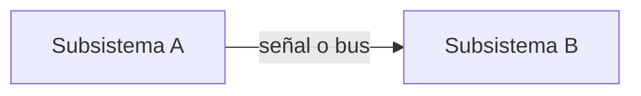

# ICD-000 · Subsistema A ↔ Subsistema B

> [!NOTE]
> Plantilla. Cópiala a `Subsistemas/icd-NNN-a-b.md`. Una interfaz solo pasa a `acordada` cuando los responsables de los dos subsistemas la aprueban (anótalo en un acta).

## Subsistemas y tipo

- Lado A: … · Lado B: …
- Tipo: mecánica | eléctrica | datos | software

## Definición

| Señal o elemento | Dirección | Tipo | Unidad | Rango | Frecuencia | Conector o pin |
|---|---|---|---|---|---|---|
| … | A → B | … | … | … | … Hz | … |

- Protocolo o formato: …
- Restricciones (masa, volumen, consumo, tiempos): …

## Verificación

| Qué se verifica | Método | Prueba |
|---|---|---|
| … | T | TST-000 |

## Cambios

- AAAA-MM-DD: versión inicial.

## Ejemplo

> [!NOTE]
> **Ejemplo** (no es una interfaz real; bórralo al usar la plantilla).
> ICD-000 · Computador de vuelo ↔ actuador: señal de mando de <tipo> a <…> Hz, rango <…>, por el pin <…>. Se verifica con TST-000 en banco.
