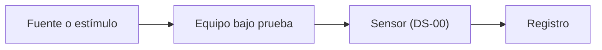

# TST-000 · Nombre de la prueba

> [!NOTE]
> Plantilla. Cópiala a `Pruebas/tst-NNN-nombre.md`. Un vuelo también es una prueba. El plan se escribe antes de ejecutar; el análisis, cuando los datos crudos estén en `raw/`.

## Objetivo

Qué queremos saber y qué decisión depende del resultado.

## Requisitos y criterios de aceptación

| Requisito | Criterio | Umbral | Método |
|---|---|---|---|
| RC-000 | **C1.** <magnitud> medida durante <condición> | ≤ <valor> <unidad> | T |

## Montaje

- Equipo bajo prueba: …
- Instrumentos (con su hoja de datos): … (DS-00)
- Diagrama:

## Procedimiento

1. …
2. …

## Datos a registrar

| Variable | Unidad | Frecuencia | Archivo en raw/ |
|---|---|---|---|
| tiempo | s (UTC, ISO 8601) | <…> Hz | `raw/pruebas/<archivo>.csv` |

## Análisis

- Script: `sim/tst-000-analisis.py`. Lee `raw/`, escribe `derivados/tst-000-*.csv` y `salida/figuras/tst-000-*.png`.
- Para reproducirlo: `python3 sim/tst-000-analisis.py`

## Resultados

<!-- Solo números que imprime o guarda el script. Coma decimal y unidad SI. -->

- **M1.** <magnitud>: <valor> <unidad> (salida del script, figura `salida/figuras/tst-000-<…>.png`).

## Veredicto

| Criterio | Resultado | ¿Cumple? |
|---|---|---|
| TST-000·C1 | TST-000·M1 | pendiente |

## Lecciones y acciones

- …

## Ejemplo

> [!NOTE]
> **Ejemplo** (no es una prueba real; bórralo al usar la plantilla).
> TST-000 · Caída del CanSat desde <altura> m con el sistema de descenso. Criterio: velocidad de descenso en <rango> m/s (RC-000). Datos: presión y aceleración a <…> Hz en `raw/pruebas/`. Resultado: **M1.** velocidad media calculada por `sim/tst-000-analisis.py`.
