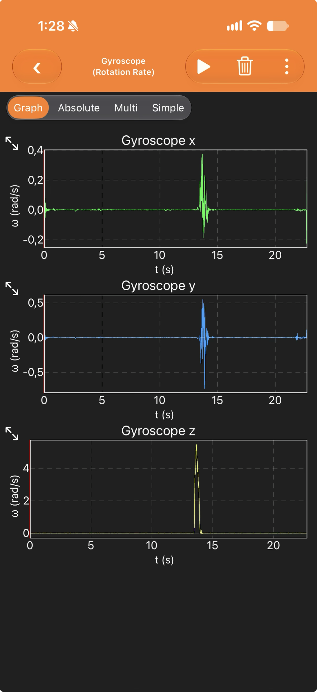
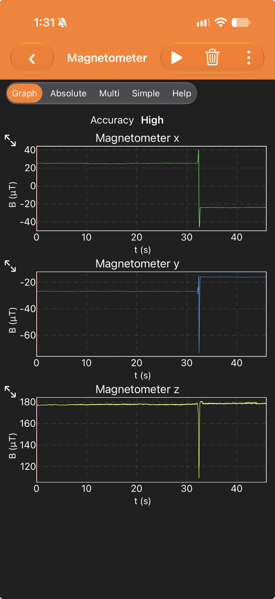
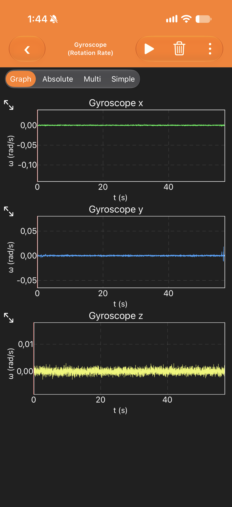
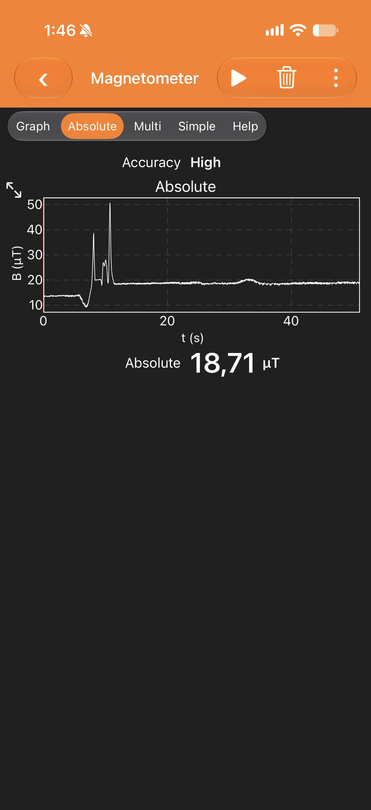

# TST-001 · Exploración del giróscopo y el magnetómetro con un celular

> [!NOTE]
> Prueba exploratoria: no verifica ningún requisito. Sirve para descubrir qué mide cada sensor antes de diseñar el lazo de rumbo (C8, C11, PQ15–PQ18). Lo que se aprendió está en [sensores-giroscopio-magnetometro.md](../Conceptos/sensores-giroscopio-magnetometro.md).

## Objetivo

Ver con datos reales qué mide un giróscopo y qué mide un magnetómetro, y en qué se diferencian, usando los sensores de un celular.

## Montaje y procedimiento

- Celular del líder de control con la app phyphox ([L-06](../raw/LINKS.md)), apoyado sobre una mesa.
- Ensayo 1: giro rápido en plano, con el giróscopo.
- Ensayo 2: giro en plano, con el magnetómetro (tres ejes).
- Ensayo 3: celular quieto unos 55 s, con el giróscopo.
- Ensayo 4: magnitud total del campo magnético, acercando y alejando objetos.

> [!WARNING]
> **Pendiente** — La fecha y el lugar exactos (ciudad y qué había cerca del celular). Las capturas solo muestran la hora: de 1:28 a 1:46.

## Datos

| Ensayo | Captura |
|---|---|
| 1 · Giróscopo durante el giro |  |
| 2 · Magnetómetro durante el giro |  |
| 3 · Giróscopo quieto |  |
| 4 · Magnitud total del campo |  |

## Resultados

> [!WARNING]
> **Pendiente** — Los valores se leyeron a ojo de las capturas y son aproximados. Para que salgan de un script (regla 4), hay que exportar los datos de phyphox (⋮ → Export Data → CSV), subirlos a `raw/inbox/` y analizarlos con `sim/tst-001-analisis.py`.

- **M1.** Giróscopo durante el giro: antes y después, ≈ 0 rad/s en los tres ejes. En t ≈ 13,7 s, el eje Z sube hasta ≈ 5,4 rad/s (≈ 310 °/s) durante menos de 0,5 s; X e Y oscilan entre ≈ −0,7 y +0,5 rad/s.
- **M2.** Giróscopo quieto durante ≈ 55 s: los tres ejes quedan dentro de ≈ ±0,003 rad/s (≈ ±0,17 °/s), con promedio visualmente ≈ 0.
- **M3.** Magnetómetro durante el giro (en t ≈ 32 s):
  - X pasa de ≈ +25 µT a ≈ −24 µT e Y de ≈ −27 µT a ≈ −16 µT, y se quedan en los valores nuevos;
  - Z se mantiene en ≈ +178 µT antes y después, con un pico transitorio de hasta ≈ 110 µT.
- **M4.** Magnitud total: ≈ 13 µT al inicio, picos de ≈ 38 µT y ≈ 50 µT entre t ≈ 8 s y 11 s, y luego ≈ 19 µT estable (valor final mostrado: 18,71 µT).

## Análisis

- **D1.** El giróscopo mide **velocidad angular**: solo cambia mientras hay giro y vuelve a ≈ 0 al detenerse (M1, M2).
- **D2.** El magnetómetro mide la **dirección del campo** en los ejes del celular: cambia con la orientación y se queda en el valor nuevo (M3).
- **S1.** El giro del ensayo 2 fue en plano, alrededor del eje Z del celular. Por eso Z casi no cambia (M3).
- **A1.** Componente horizontal medida: √(25² + 27²) ≈ 36,8 µT antes y √(24² + 16²) ≈ 28,8 µT después. Con un campo uniforme, un giro en plano no cambia esa magnitud. Que cambie indica un campo que gira con el celular: la **distorsión de hierro duro** (hard iron).
- **A2.** Z ≈ 178 µT es muy superior al campo vertical que da el modelo en Bogotá (≈ 13,3 µT) o en Medellín (≈ 15,1 µT), según [campo-geomagnetico.py](../sim/campo-geomagnetico.py). En el ensayo 4, el total (≈ 19 µT) queda por debajo de los ≈ 30 µT del modelo. La lectura depende mucho del entorno y del propio celular.
  - **S2.** Hipótesis por confirmar: imanes del propio celular, objetos cercanos (portátil, mesa metálica) o la estructura del edificio.
- **A3.** Por qué no basta el giróscopo solo (cálculo ilustrativo, no medido): un sesgo de 0,01 rad/s integrado durante 120 s da 1,2 rad ≈ 69°, casi siete veces los 10° de C8.

## Veredicto

**No concluyente**, porque es exploratoria y no tiene criterio de aceptación.

## Lecciones

1. El giróscopo es rápido, pero mide velocidad: hay que integrarlo y deriva.
2. El magnetómetro da el norte, pero escucha cualquier campo cercano. Hay que calibrarlo y alejarlo de imanes, motores y baterías; para eso está el brazo de 220 mm (PQ10).
3. Ninguno basta solo: hay que combinarlos.
