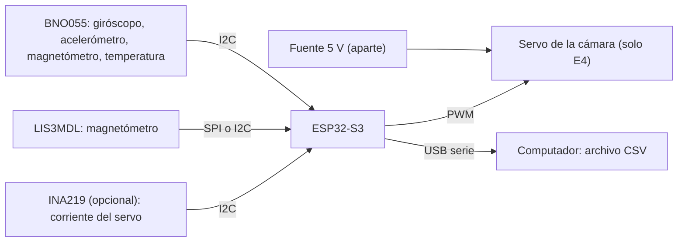

# TST-002 · Guía de laboratorio: datos estacionarios del giróscopo, el magnetómetro y el acelerómetro

> [!NOTE]
> Guía para quien arma el banco (el compañero de ingeniería eléctrica). Ningún ensayo necesita vuelo: el sensor está **quieto** en cada registro. Lo que se entrega son archivos CSV, una bitácora y fotos, que entran al brain por `raw/inbox/`. El análisis lo hace después el frente de control con un script (regla 4).

> [!WARNING]
> **Pendiente**
> - Nombre del responsable y fecha.
> - Ciudad y sitio de la prueba (Bogotá o Medellín): cambia el campo de referencia (tabla de C7).
> - Modelo del servo. `Servos.pdf` está en `raw/inbox/` sin procesar; mientras tanto se usa el rango de pulso de [servo-prueba-futaba.m](../sim/servo-prueba-futaba.m) (0,6 a 2,4 ms), que tampoco está confirmado.
> - Los RQ literales todavía no están cargados como notas (`Mision/`), así que `requisitos` va vacío. Los criterios citan el número de la guía oficial y su página.

> [!WARNING]
> **Sin fuente en raw/** — las hojas de datos oficiales del BNO055 y del LIS3MDL ([L-08 y L-09](../raw/LINKS.md)) no están en `raw/datasheets/`. Los modos, rangos y registros que nombra esta guía hay que confirmarlos en esas hojas antes de programar el ESP32.

## Objetivo

Medir con **los sensores reales**, montados en el ESP32-S3, los parámetros que hoy son supuestos en la simulación del lazo de la cámara. Los datos del celular de [TST-001](tst-001-exploracion-sensores-celular.md) solo sirvieron para entender qué mide cada sensor.

De los resultados dependen cuatro decisiones:

1. **Si el error de rumbo cabe en C8 de la guía** (±10°). En la simulación, el error de control es ≤ 0,27°. El error total, ≈ 2,5–3,1°, lo pone casi todo el estimador de rumbo, que se alimenta de estos sensores ([diseño de estabilización](../Control/diseno-estabilizacion-camara.md), M1).
2. **Qué magnetómetro da MAG_X, MAG_Y y MAG_Z en la telemetría.** El LIS3MDL cumpliría PQ30; el BNO055, con ≈ 3 mG por paso (no validado), no ([sensores](../Conceptos/sensores-giroscopio-magnetometro.md), conclusión 2).
3. **El umbral del estimador en línea de la planta.** El estimador solo debe actualizarse cuando la señal supera el ruido de los sensores, así que ese ruido hay que medirlo.
4. **A qué distancia del servo puede ir el magnetómetro**, y si hace falta blindaje o el brazo de 220 mm de PQ10.

## Qué datos se necesitan y para qué

| Dato | Sensor | Para qué sirve | Valor que se usa hoy (supuesto) | Ensayo |
|---|---|---|---|---|
| Sesgo del giróscopo por eje (bias), en °/s | BNO055 | el estimador lo resta; si no se corrige, el rumbo deriva sin límite | 0,5 °/s ([diseno-estabilizacion-camara.py](../sim/diseno-estabilizacion-camara.py#L150)); 1 °/s típico de otra pieza (L-15, no validado) | E1, E2 |
| Repetibilidad del sesgo entre encendidos | BNO055 | PQ21 obliga a que el PocketQube esté apagado en el contenedor: el sesgo no se puede medir justo antes del vuelo | sin dato | E1 |
| Ruido del giróscopo por muestra a 100 Hz y densidad de ruido, en °/s/√Hz | BNO055 | ruido del estimador y umbral del estimador en línea | 0,1 °/s por muestra ([línea 151](../sim/diseno-estabilizacion-camara.py#L151)); 0,014 °/s/√Hz de otra pieza (L-14) | E1 |
| Estabilidad del sesgo en el tiempo (varianza de Allan, Allan variance) | BNO055 | cuánto se aleja el sesgo durante los 2 a 3 min del descenso | sin dato | E2 |
| Deriva del sesgo con la temperatura | BNO055 | el sensor se calienta después de encender | sin dato | E2 |
| Paso mínimo (resolución) de cada sensor | los tres | verificar PQ28, PQ29 y PQ30 | 1/16 °/s (L-10), 0,146 mG (Notion), ≈ 3 mG (L-11) | E1 |
| Ruido del magnetómetro por eje, en mG rms | LIS3MDL y BNO055 | se convierte en ruido de rumbo: $\sigma_\psi=\sigma_B/H$ | 3,2 mG (L-13, no validado), es decir 0,9° por muestra ([línea 152](../sim/diseno-estabilizacion-camara.py#L152)) | E1 |
| Desfase y deformación del campo (hierro duro y blando, hard iron y soft iron) | LIS3MDL y BNO055 | calibrar el magnetómetro: la telemetría pide valores **calibrados** (p. 26) | sin dato | E3 |
| Sesgo y factor de escala del acelerómetro | BNO055 | nivelar el magnetómetro: la inclinación sin compensar es la fuente dominante de error en Virginia | sin dato | E3 |
| Campo que agrega el servo según la distancia y su estado | LIS3MDL y BNO055 | ubicación del magnetómetro y del servo | 30 mm sin brazo y 220 mm con brazo, supuestos ([caracterizacion-sensores.py](../sim/caracterizacion-sensores.py#L38-L39)) | E4 |
| Periodo real de muestreo y muestras perdidas | ESP32-S3 | la simulación supone un lazo a 100 Hz (10 ms, base Hardware de Notion) | 10 ms | E0 y todos |

## Requisitos y criterios de aceptación

Las tres primeras filas son requisitos de la guía oficial. Las demás son **supuestos de diseño** de la simulación (interpretación propia, no texto de la guía): si el dato medido es peor, no «falla» la prueba, sino que hay que volver a simular con el valor real.

| Origen | Criterio | Umbral | Método |
|---|---|---|---|
| PQ28 (p. 15) | **C1.** Paso mínimo del giróscopo del BNO055 en los tres ejes, en E1 | ≤ 0,1 °/s | T |
| PQ30 (p. 15) | **C2.** Paso mínimo del magnetómetro en los tres ejes, en E1, para el LIS3MDL y el BNO055 por separado | ≤ 1 mG | T |
| PQ29 (p. 15) | **C3.** Paso mínimo del acelerómetro del BNO055 en los tres ejes, en E1 | ≤ 0,001 m/s² | T |
| Supuesto de diseño | **C4.** Ruido de rumbo por muestra con el LIS3MDL quieto: $\sigma_\psi=\sigma_B/H$, con $H$ el campo horizontal del sitio | ≤ 0,9° rms | A |
| Supuesto de diseño | **C5.** Sesgo del giróscopo en Z tras encender, peor de las corridas de E1 | ≤ 0,5 °/s | A |
| C8 de la guía (p. 9) | **C6.** Campo del servo perpendicular al campo horizontal, con el servo a 220 mm (PQ10) y en su peor estado de E4 | **Pendiente**: acordar cuántos grados de los 10° se le dan. Referencia: 4,7 mG dejan 1° en Bogotá y Medellín, y 3,7 mG en Monterey ([campo-geomagnetico.csv](../derivados/campo-geomagnetico.csv)) | T |
| Telemetría (p. 26) | **C7.** Magnitud del campo calibrado en el sitio de la prueba, igual en todas las poses de E3 | Referencia WMM2025: 299 mG en Bogotá y 308 mG en Medellín ([caracterizacion-sensores.csv](../derivados/caracterizacion-sensores.csv)). Tolerancia **Pendiente** | A |

## Montaje

- **Equipo bajo prueba:** ESP32-S3 DevKit N16R8, BNO055 y LIS3MDL, que son los seleccionados en la base Hardware de Notion ([copia](../raw/datos/notion-hardware-2026-10-25.md)). Para E4, el servo de la cámara.
- **Bus:**
  - BNO055 por I²C.
  - LIS3MDL por SPI o por I²C a baja velocidad, como recomienda la base Hardware cuando el cable mide 220 mm.
  - Usar el mismo cableado que irá en vuelo, si ya existe.
- **Alimentación del servo:** fuente aparte de 5 V con tierra común con el ESP32, para que los picos de corriente no reinicien el ESP32. El PWM del ESP32 sale a 3,3 V; confirmar en la hoja del servo que acepta ese nivel. Si hay un INA219 a mano (seleccionado en Notion), medir con él la corriente del servo.
- **Superficie:**
  - mesa de madera o plástico, sin tornillos ni patas de hierro cerca del sensor;
  - lejos de computadores portátiles, fuentes conmutadas, celulares, parlantes e imanes;
  - el computador de registro, a la mayor distancia que permita el cable USB.
- **Ejes:**
  - marcar X, Y y Z de cada sensor sobre la tarjeta y fotografiarlos;
  - los dos sensores se montan con los ejes alineados entre sí;
  - la guía define los ejes de telemetría en la p. 25 y pide considerarlos al montar las unidades inerciales.
- **Instrumentos auxiliares:**
  - rosa de 8 rumbos impresa (cada 45°), pegada a la mesa;
  - regla o cinta métrica para E4;
  - termómetro ambiente si hay;
  - un bloque o caja de caras perpendiculares para E3.

> [!WARNING]
> **Sin fuente en raw/** — no hay hojas de datos (DS) del BNO055, del LIS3MDL ni del servo en `raw/datasheets/`. Cuando se suban, este montaje citará su DS.



### Configuración del registro (firmware)

1. **Datos crudos:** guardar los enteros que entrega cada sensor (LSB), no solo unidades convertidas. Los factores de conversión van en el encabezado del archivo y la conversión la hace el script.
2. **BNO055:**
   - registrar en un modo **sin fusión**, que entregue giróscopo, acelerómetro y magnetómetro crudos (en la hoja de datos se llama AMG; **confirmar en L-08**);
   - hacer una corrida extra de E1 en modo de fusión (NDOF) para comparar.
   - Rango del giróscopo: el que se usará en vuelo. **Pendiente** decidirlo con control; como referencia, el giro del cuerpo simulado en S2 llega a ≈ 90 °/s más la oscilación, y en TST-001 un giro a mano llegó a ≈ 310 °/s.
3. **LIS3MDL:**
   - rango de ±4 gauss, el que da 0,146 mG por LSB según la base Hardware;
   - frecuencia de salida (output data rate, ODR): la más alta que no sea de bajo consumo. El ruido depende del modo (L-13), así que hay que anotar el modo y la frecuencia configurados.
4. **Lazo de registro a 100 Hz** (cada 10 ms), con temporizador, no con `delay()`.
   - En cada ciclo se leen todos los sensores y se escribe una fila con `t_us` (`micros()` del ESP32).
   - Si un sensor entrega datos más despacio que 100 Hz, se repite su último valor y la columna `*_nuevo` vale 0. Nunca se inventa un valor.
5. **Ancho de banda del puerto serie:** una fila de ≈ 200 caracteres a 100 Hz pide ≈ 200 kbit/s. A 921 600 baudios sobra; a 115 200 se pierden muestras.
6. **Hora UTC:** al iniciar cada archivo, el computador escribe la hora UTC de arranque en el encabezado (en Linux: `date -u +%FT%TZ`). Los tiempos de cada fila son relativos a ese arranque.

### Formato del archivo

Un archivo por corrida, CSV con punto decimal, líneas de encabezado que empiezan con `#` y una fila por ciclo de 10 ms:

```text
# ensayo: E1  corrida: 2  archivo: tst-002-e1-quieto-c2.csv
# inicio_utc: 2026-11-12T15:04:00Z   lugar: <ciudad, edificio, mesa>
# bno055: modo=AMG  rango_giro=<...>  rango_acel=<...>  firmware=<commit o versión>
# lis3mdl: rango=4gauss  odr=<...>  modo=<...>  bus=<SPI|I2C> <velocidad>
# conversion: bno_giro=16 LSB por deg/s  bno_acel=<...>  bno_mag=<...>  lis_mag=6842 LSB por gauss
# servo: <modelo>  distancia_mm=<...>  (solo E4)
t_us,bno_gx,bno_gy,bno_gz,bno_ax,bno_ay,bno_az,bno_mx,bno_my,bno_mz,bno_temp_c,bno_nuevo,lis_mx,lis_my,lis_mz,lis_nuevo,servo_estado,servo_pulso_us,ina_ma
0,-3,1,2,12,-5,981,215,-110,402,24,1,1830,-940,3260,1,S0,0,
10003,-2,1,3,11,-4,982,215,-110,402,24,0,1826,-943,3258,1,S0,0,
```

Los números de la muestra son ilustrativos y solo enseñan el formato: no son datos.

## Procedimiento

Antes de cada ensayo se anota una fila en la bitácora (tabla del final). Durante el registro **nadie toca la mesa** y no se acercan celulares ni herramientas.

### E0 · Verificación del registro (5 min)

1. Encender, esperar 1 min y registrar 60 s con los sensores quietos.
2. Comprobar que el archivo tiene ≈ 6000 filas, que la diferencia de `t_us` entre filas es ≈ 10 000 µs y que no hay saltos ni filas cortadas.
3. Tomar fotos del montaje, de los ejes marcados y del entorno de la mesa.

### E1 · Quieto, corto, con apagados (≈ 40 min)

1. Sensores con Z hacia arriba, sobre la mesa. Servo **desconectado**.
2. Registrar **10 min** desde el encendido (corrida 1).
3. Apagar todo 2 min, volver a encender y registrar otros 10 min (corrida 2). Repetir para la corrida 3.
4. Con el BNO055 en modo de fusión (NDOF), una corrida más de 5 min (corrida 4).

### E2 · Quieto, largo (≥ 2 h, sin vigilancia)

1. Partir con todo apagado y frío (al menos 30 min apagado).
2. Encender y registrar **al menos 2 h** sin mover nada. Registrar `bno_temp_c` y, si hay, la temperatura ambiente al inicio y al final.
3. Si el ESP32 o el computador se reinician, anotar la hora y empezar un archivo nuevo. No se empalman archivos a mano.

### E3 · Poses estáticas (≈ 25 min)

Sirve para calibrar el magnetómetro y el acelerómetro sin mover el sensor durante el registro: se cambia de pose, se espera quieto y se registra.

1. **Seis caras:** con la tarjeta fija en el bloque, apoyar cada cara (+X, −X, +Y, −Y, +Z y −Z hacia arriba). En cada pose, esperar 5 s quieto y registrar **30 s**.
2. **Ocho rumbos:** con Z hacia arriba, girar el bloque sobre la rosa de rumbos en pasos de 45° (0°, 45°, …, 315°). Esperar 5 s y registrar **30 s** en cada rumbo. Anotar qué rumbo de la rosa apunta a una referencia fija de la sala (una pared, por ejemplo).
3. Un archivo por pose, o uno solo con la pose anotada en `servo_estado` como `P+X`, `R045`, etc. Lo que se elija se anota en la bitácora.
4. **Opcional** (no es estacionario): 60 s girando la tarjeta despacio, a mano, en todas las direcciones. Es útil para la calibración completa.

> [!NOTE]
> Interpretación: esta calibración solo corrige el hierro de la tarjeta y del bloque. La definitiva se hace con el magnetómetro en la punta del brazo desplegado, porque allí cambia el entorno ([sensores](../Conceptos/sensores-giroscopio-magnetometro.md), conclusión 4).

### E4 · Interferencia del servo (≈ 40 min)

1. Sensores fijos con Z hacia arriba, en un rumbo anotado.
2. Poner el servo a **30, 60, 110 y 220 mm** del LIS3MDL (centro a centro), sobre una línea marcada en la mesa. 30 mm es el caso «sin brazo» supuesto en la caracterización y 220 mm es el brazo de PQ10; 60 y 110 mm son puntos intermedios. Anotar en qué dirección queda el servo respecto a los ejes del sensor.
3. En cada distancia, registrar **30 s** por estado, en este orden:

| Estado | `servo_estado` | Qué se hace |
|---|---|---|
| Sin alimentar | `S0` | servo en su sitio, fuente apagada |
| Alimentado, sin señal | `S1` | fuente encendida, sin PWM |
| Sosteniendo el centro | `S2` | PWM fijo de 1,5 ms, el centro del rango de 0,6 a 2,4 ms |
| Barrido | `S3` | barrido continuo entre 0,6 y 2,4 ms, unos 2 s de ida y vuelta; `servo_pulso_us` registra el pulso de cada ciclo |

4. Si la batería de vuelo (18650) está disponible, repetir `S0` y `S3` con la batería a las mismas distancias.

## Datos a registrar

| Variable | Unidad | Frecuencia | Archivo en `raw/inbox/` (luego `raw/pruebas/`) |
|---|---|---|---|
| tiempo | µs desde el arranque, con `inicio_utc` (ISO 8601, UTC) en el encabezado | 100 Hz | todos |
| giróscopo X, Y, Z del BNO055 | LSB (16 LSB por °/s, L-10, por confirmar) | 100 Hz | todos |
| acelerómetro X, Y, Z del BNO055 | LSB (factor del encabezado) | 100 Hz | todos |
| magnetómetro X, Y, Z del BNO055 | LSB (factor del encabezado) | lo que entregue, con `bno_nuevo` | todos |
| magnetómetro X, Y, Z del LIS3MDL | LSB (6842 LSB por gauss en ±4 gauss, L-12, por confirmar) | su frecuencia de salida, con `lis_nuevo` | todos |
| temperatura del BNO055 | °C | 100 Hz (cambia despacio) | todos |
| estado y pulso del servo | código y µs | 100 Hz | E4 (en los demás, `S0` y 0) |
| corriente del servo (opcional) | mA | 100 Hz | E4 |

Nombres de archivo: `tst-002-e0-verificacion.csv`, `tst-002-e1-quieto-c1.csv` … `-c4.csv`, `tst-002-e2-quieto-largo.csv`, `tst-002-e3-poses.csv` (o uno por pose), `tst-002-e4-servo-d030.csv` … `-d220.csv`, más `tst-002-bitacora.md` y las fotos `tst-002-montaje-*.jpg`. Todo se deja en `raw/inbox/` y se procesa con la skill `subir`.

### Bitácora (copiar y llenar)

| Ensayo | Archivo | Inicio (UTC) | Fin (UTC) | Lugar | Pose o rumbo | Distancia del servo | Estado del servo | T ambiente | Observaciones |
|---|---|---|---|---|---|---|---|---|---|
| E0 | | | | | | — | — | | |

## Análisis

- Script por escribir cuando lleguen los datos: `sim/tst-002-analisis.py`. Lee solo `raw/pruebas/`, escribe `derivados/tst-002-*.csv` y `salida/figuras/tst-002-*.png`, e imprime las métricas.
- **Qué calcula:**
  - por eje y por corrida: media (sesgo), desviación estándar (ruido), densidad de ruido y paso mínimo;
  - la desviación de Allan de E2 y la deriva del sesgo frente a la temperatura;
  - el ajuste de elipsoide de E3 (hierro duro y blando) y la magnitud calibrada;
  - el ruido de rumbo $\sigma_\psi=\sigma_B/H$;
  - en E4: el cambio del campo frente a `S0` en cada estado y distancia, su componente perpendicular a $H$ y los grados de rumbo que equivale;
  - el periodo real de muestreo y las muestras perdidas.
- **Después:**
  - reemplazar los supuestos de [diseno-estabilizacion-camara.py](../sim/diseno-estabilizacion-camara.py#L150-L153) y de [caracterizacion-sensores.py](../sim/caracterizacion-sensores.py#L27-L34) por los valores medidos;
  - volver a correr la comparación de las leyes de control.
- Para reproducirlo: `python3 sim/tst-002-analisis.py`.

## Resultados

> [!WARNING]
> **Pendiente** — sin datos todavía.

## Veredicto

| Criterio | Resultado | ¿Cumple? |
|---|---|---|
| TST-002·C1 | — | pendiente |
| TST-002·C2 | — | pendiente |
| TST-002·C3 | — | pendiente |
| TST-002·C4 | — | pendiente |
| TST-002·C5 | — | pendiente |
| TST-002·C6 | — | pendiente |
| TST-002·C7 | — | pendiente |

## Riesgos de la prueba

- **Campo del edificio:** el hierro de la mesa o de la estructura deforma el campo y se confunde con el hierro del sensor. Mitigación: hacer E1 y E3 en el mismo lugar, fotografiarlo y comparar la magnitud calibrada con la del WMM (C7).
- **Reinicios por el servo:** un pico de corriente puede reiniciar el ESP32 si comparten fuente. Mitigación: fuente aparte con tierra común; un salto en `t_us` lo delata.
- **Muestras perdidas por el puerto serie:** se ven en E0. Mitigación: subir los baudios o reducir columnas.
- No se registra un RSK nuevo. El recorrido del servo ya está en [RSK-001](../Riesgos/rsk-001-rango-servo-camara.md).

## Lecciones y acciones

- Siguiente prueba de banco, ya con el actuador: identificar el servo (o el motor) aplicando una señal binaria pseudoaleatoria (SBPA) por PWM y midiendo el ángulo, para fijar $K_c$ y $\tau_c$ y los valores iniciales del estimador en línea ([diseño de estabilización](../Control/diseno-estabilizacion-camara.md), sección 8).
