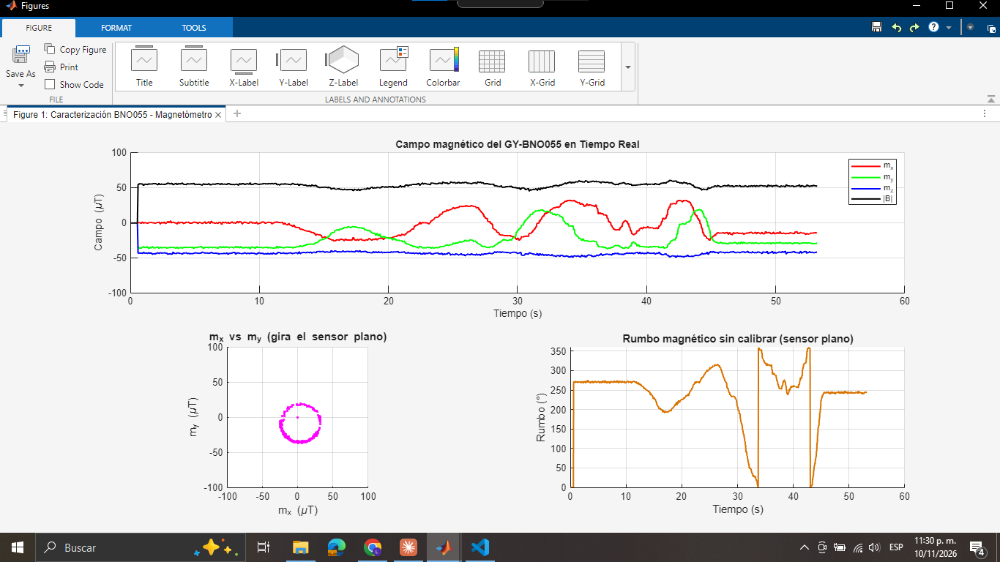
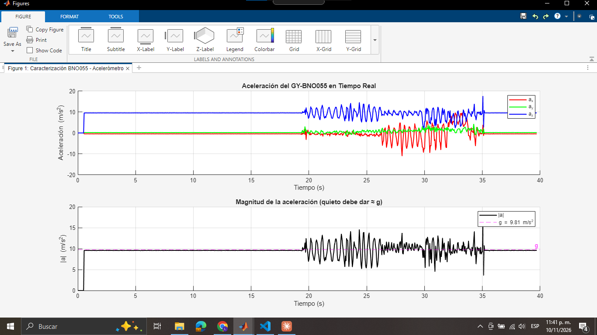
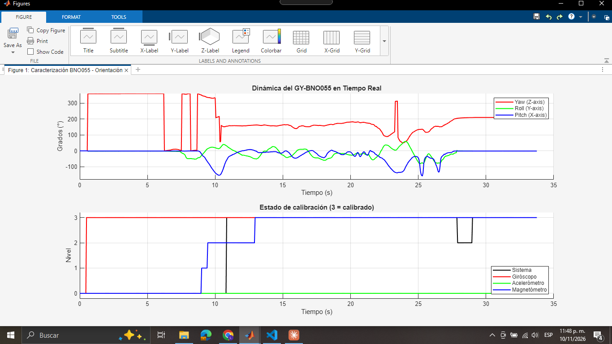

# TST-003 · Primera lectura del BNO055 real sin calibrar (ESP32 y MATLAB)

> [!NOTE]
> Es una prueba exploratoria y no verifica ningún requisito. Es la primera vez que se lee el BNO055 real, con tres programas de PlatformIO y tres scripts de MATLAB que grafican en vivo. **No es la ejecución de [TST-002](tst-002-guia-datos-estacionarios-sensores.md)**: difiere en la tarjeta, la frecuencia, las unidades y los sensores (ver la tabla de diferencias). Lo que cambia en el control está en [diseno-estabilizacion-camara](../Control/diseno-estabilizacion-camara.md), sección 9.

> [!WARNING]
> **Pendiente**
> - **Los CSV.** Cada script de MATLAB guarda un CSV junto a sí mismo (`acelerometro_AAAA-MM-DD_HHmmss.csv`, `magnetometro_…`, `orientacion_…`), pero no llegaron. Solo hay capturas de pantalla, así que todos los valores de esta nota son lectura visual (regla 4). Hay que pedirlos y subirlos por `raw/inbox/`, para analizarlos con `sim/tst-003-analisis.py`.
> - El sitio (ciudad, mesa, qué había cerca) y la orientación de los ejes de la tarjeta.
> - La zona horaria de las capturas. Se supone America/Bogota: el reloj de Windows marca el 10/11/2026 entre las 11:30 p. m. y las 11:48 p. m., es decir, entre 2026-11-11T04:30Z y 2026-11-11T04:48Z.

## Objetivo

Comprobar que el BNO055 responde con el ESP32. Además:
- ver cómo se ven el acelerómetro y el magnetómetro crudos (modo AMG) y la orientación con fusión (modo NDOF) antes de calibrar;
- preparar la calibración que describe la guía del compañero ([tst-003-guia-calibracion-bno055.md](../raw/pruebas/tst-003-guia-calibracion-bno055.md)).

## Montaje (de las fuentes)

- **C1.** Tarjeta `esp32dev` (ESP32 clásico), framework Arduino, librerías Adafruit BNO055 ^1.6.3 y Adafruit Unified Sensor ^1.1.14 ([platformio.ini](../raw/pruebas/tst-003-platformio.ini); los tres proyectos traen el mismo archivo).
- **C2.** El BNO055 va por I²C en la dirección `0x29`, con cristal externo (`setExtCrystalUse(true)`). El periodo de muestreo es de 50 ms (20 Hz) con `millis()` y el puerto serie va a 115 200 baudios ([firmware del acelerómetro](../raw/pruebas/tst-003-firmware-acelerometro.cpp)).
- **C3.** Tres programas:

| Programa (carpeta original) | Modo del BNO055 | Trama | Script de MATLAB | Captura |
|---|---|---|---|---|
| [firmware-magnetometro](../raw/pruebas/tst-003-firmware-magnetometro.cpp) (`Prueba_Magnetometro`) | AMG, sin fusión | `t_ms,mx,my,mz` en µT | [matlab-magnetometro](../raw/pruebas/tst-003-matlab-magnetometro.m) | 1, 11:30 p. m. |
| [firmware-acelerometro](../raw/pruebas/tst-003-firmware-acelerometro.cpp) (`Prueba_Acelerometro`) | AMG, sin fusión | `t_ms,ax,ay,az` en m/s² | [matlab-acelerometro](../raw/pruebas/tst-003-matlab-acelerometro.m) | 2, 11:41 p. m. |
| [firmware-orientacion-ndof](../raw/pruebas/tst-003-firmware-orientacion-ndof.cpp) (`Prueba_Giroscopio`) | NDOF, fusión de 9 ejes | `t_ms,yaw,roll,pitch,cal_sys,cal_gir,cal_acel,cal_mag` | [matlab-orientacion](../raw/pruebas/tst-003-matlab-orientacion.m) | 3, 11:48 p. m. |

- **C4.** La carpeta `Prueba_Giroscopio` contiene el programa de orientación NDOF, no un registro del giróscopo crudo. La guía del compañero lo confirma: el proyecto AMG del giróscopo «falta» (sección 3.1). **No hay datos del giróscopo crudo.**
- **C5.** Los scripts de MATLAB leen el puerto `COM7`, capturan hasta 5000 muestras, grafican en vivo, imprimen media, desviación y frecuencia real, y guardan el CSV.

### Diferencias con el plan de TST-002

| Aspecto | TST-002 (plan) | TST-003 (lo que se hizo) | Consecuencia |
|---|---|---|---|
| Tarjeta | ESP32-S3 DevKit N16R8 (base Hardware) | ESP32 clásico (`esp32dev`) | la tarjeta de vuelo sigue sin decidir; la base Hardware advierte problemas de I²C del BNO055 con el ESP32-S3 |
| Frecuencia | 100 Hz con temporizador | 20 Hz con `millis()` | no sirve para medir ruido ni latencia a la frecuencia del lazo |
| Datos | enteros crudos (LSB) y encabezado con la conversión | unidades ya convertidas, con 2 o 3 decimales | no se puede verificar el paso mínimo (PQ28, PQ29, PQ30) |
| Sensores | BNO055 y LIS3MDL | solo el BNO055 | falta el magnetómetro del brazo |
| Giróscopo crudo | E1 y E2 | ninguno (C4) | el sesgo y el ruido del giróscopo siguen siendo supuestos |
| Hora | UTC en el encabezado | solo el reloj de las capturas | — |

## Datos

| Ensayo | Captura |
|---|---|
| 1 · Magnetómetro crudo (AMG), girando el sensor plano |  |
| 2 · Acelerómetro crudo (AMG), quieto, después moviéndolo a mano y quieto otra vez |  |
| 3 · Orientación NDOF y estado de calibración interna |  |

## Resultados (lectura visual)

> [!WARNING]
> **Pendiente** — Los valores se leyeron a ojo de las capturas y son aproximados. Los reemplazan los que calcule `sim/tst-003-analisis.py` cuando lleguen los CSV.

- **M1.** Magnetómetro, ≈ 53 s:
  - $\lvert B\rvert$ ≈ 50–57 µT durante toda la corrida;
  - $m_z$ ≈ −43 µT, casi constante mientras el sensor gira plano;
  - $m_x$ va de ≈ −25 a ≈ +32 µT y $m_y$, de ≈ −37 a ≈ +19 µT.
- **M2.** Plano $m_x$–$m_y$: los puntos trazan un círculo. A ojo, su centro está cerca de (+4, −9) µT y su radio es de ≈ 28 µT. En el rumbo sin calibrar, el salto de 360° a 0° aparece en t ≈ 33 s y t ≈ 43 s.
- **M3.** Acelerómetro quieto (de 0,5 a 19 s y de 35 a 40 s):
  - $a_z$ ≈ 9,5 m/s², $a_x$ ≈ −0,5 m/s² y $a_y$ ≈ 0;
  - $\lvert a\rvert$ queda un poco por debajo de la línea de 9,81 m/s².
- **M4.** Acelerómetro moviéndolo a mano (de 19 a 35 s): los ejes oscilan entre ≈ −11 y ≈ +17 m/s², y $\lvert a\rvert$ entre ≈ 4 y ≈ 17 m/s².
- **M5.** Calibración interna en NDOF, ≈ 34 s:
  - el giróscopo llega a 3 en ≈ 0,5 s;
  - el magnetómetro pasa por 1 y 2 desde t ≈ 9 s y llega a 3 en t ≈ 13 s, cuando empieza el movimiento;
  - el sistema llega a 3 en ≈ 11 s, baja a 2 entre ≈ 28 y 29 s y vuelve a 3;
  - **el acelerómetro se queda en 0 toda la corrida**.
- **M6.** Yaw en NDOF:
  - mientras el magnetómetro no está calibrado (de 0,5 a 9 s), salta varias veces entre ≈ 0° y ≈ 360°, con roll y pitch en 0;
  - después se mueve entre ≈ 100° y ≈ 210°, con un salto aislado a ≈ 310° en t ≈ 23,4 s;
  - el pitch llega a ≈ −150° en t ≈ 10 s.

## Análisis

- **D1. Hierro duro en el plano.** El centro del círculo de M2 no está en el origen. La guía del compañero (sección 1) lo explica como hierro duro: un vector fijo que se suma al campo.
- **P1. Error de rumbo por un desfase horizontal.** Un desfase $b_h$ frente a un campo horizontal $H$ desvía el rumbo hasta

$$
\Delta\psi_{\max}=\arcsin\frac{b_h}{H}
$$

  Con la lectura visual de M2 ($b_h\approx\sqrt{4^2+9^2}\approx10$ µT y $H\approx28$ µT) da del orden de 20°. Es el **doble** de la meta de C8 (±10°), y la simulación supone 1,5° de residuo de calibración. Es un orden de magnitud, no un resultado: lo confirma el script con el CSV.
- **D2. El eje Z no se puede calibrar con un giro plano.** El radio del círculo (≈ 28 µT) se parece al campo horizontal del modelo WMM2025 en Bogotá (26,8 µT) y en Medellín (26,9 µT) ([campo-geomagnetico.csv](../derivados/campo-geomagnetico.csv)). En cambio, $\lvert B\rvert$ ≈ 52 µT queda muy por encima del campo total (29,9 y 30,8 µT). La diferencia está casi toda en $m_z$ (≈ −43 µT, cuando la componente vertical del sitio es de 13,3 o 15,1 µT). Hay dos explicaciones posibles: hierro duro en Z o un campo local de la mesa. Un giro plano no las separa; hace falta girar el sensor en todas las direcciones (guía, sección 3.3).
- **P2. Por qué importa el eje Z.** Nivelar el magnetómetro mezcla $m_z$ con el rumbo cuando el sensor se inclina. Un desfase en Z sin corregir, $b_z$, a una inclinación $\delta$ desvía el rumbo en $\approx b_z\sin\delta/H$. En Monterey, $H$ = 21,4 µT, el más bajo de los tres sitios, así que el efecto es mayor allí.
- **D3. El acelerómetro no mide la gravedad mientras el cuerpo se mueve.** En M4, $\lvert a\rvert$ se aleja de $g$ hasta ±7 m/s² cuando se mueve a mano. Confirma, en banco, la idea de P3 del [diseño](../Control/diseno-estabilizacion-camara.md): la inclinación para nivelar el magnetómetro debe salir de un filtro de actitud con giróscopos, y el acelerómetro solo puede corregirlo cuando $\lvert a\rvert\approx g$.
- **D4. Escala del acelerómetro.** Con el sensor quieto, $\lvert a\rvert$ queda por debajo de $g$ (M3): hay error de escala o de sesgo. Se corrige con el método de las 6 poses (guía, sección 3.2).
- **D5. La calibración interna de NDOF no sirve tal cual en vuelo.**
  - El magnetómetro necesitó movimiento para llegar a 3, y el acelerómetro no llegó en toda la corrida (M5).
  - Mientras no estaba calibrado, el yaw saltó entre 0° y 360° con el sensor quieto (M6).
  - PQ21 obliga a que el PocketQube vaya apagado en el contenedor, y la guía del compañero lo advierte: «no habrá tiempo de dibujar ochos». Para volar hay que cargar constantes de calibración guardadas, medidas con el montaje final.
- **D6. Envoltura del ángulo.** NDOF entrega el yaw entre 0° y 360°, y el rumbo calculado salta en el norte (M2, M6). El estimador debe trabajar con la diferencia envuelta a ±180°, como ya hace el modelo (la innovación con `wrap` en [diseno-estabilizacion-camara.py](../sim/diseno-estabilizacion-camara.py)), y la telemetría debe desenrollar el ángulo antes de derivarlo.

## Veredicto

No concluyente: es exploratoria y sin CSV. Sirve para tres cosas:
- el BNO055 responde por I²C con el ESP32 clásico en los modos AMG y NDOF;
- sin calibrar, el rumbo magnético quedaría fuera de C8 (P1, orden de magnitud);
- la calibración automática de NDOF no es utilizable en vuelo (D5).

## Lecciones y acciones

1. Pedir al compañero los tres CSV que guardó MATLAB y subirlos por `raw/inbox/`.
2. Para TST-002: registrar a 100 Hz, con enteros crudos, a 921 600 baudios, con el giróscopo en AMG y con el LIS3MDL. Esta prueba no reemplaza sus ensayos E0 a E4.
3. Seguir el plan de códigos de la guía del compañero (sección 6), en este orden: giróscopo crudo, calibración del acelerómetro con 6 poses y calibración del magnetómetro con elipsoide (`magcal`; el *Sensor Fusion and Tracking Toolbox* está instalado en el MATLAB del líder).
4. Hacer la calibración del magnetómetro definitiva con el montaje final (servo, batería y brazo en su sitio), y guardar sus constantes en el firmware.

> [!WARNING]
> **Sin fuente en raw/** — La guía del compañero cita la API de Adafruit y los registros de offsets `0x55` a `0x6A` (22 bytes) sin la hoja de datos oficial del BNO055 (L-08, aún no está en `raw/`).
