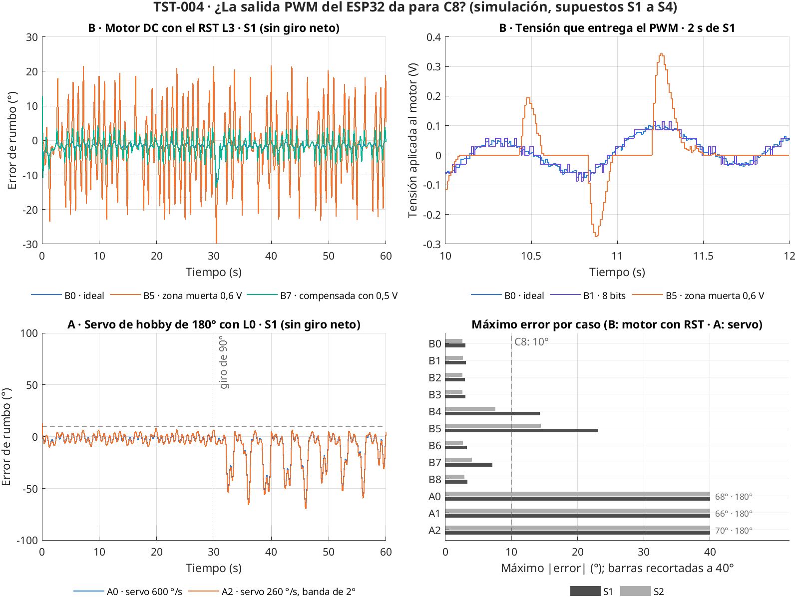
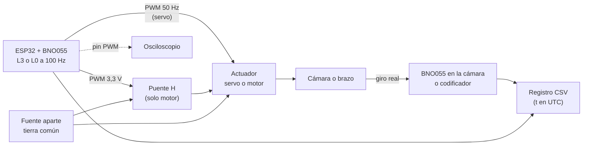

# TST-004 · Salida PWM del ESP32 al actuador de la cámara

> [!NOTE]
> La nota tiene dos partes:
> 1. **Simulación previa, ya hecha.** Responde si la salida PWM del ESP32 da o no da para C8, con los supuestos S1 a S4 del [diseño del lazo](../Control/diseno-estabilizacion-camara.md). La corrió Claude en MATLAB y Simulink ([tst_004_pwm_actuador.m](../sim/tst_004_pwm_actuador.m)), y Codex hizo una réplica independiente en Python ([tst-004-pwm-actuador.py](../sim/tst-004-pwm-actuador.py)) para cruzar los números.
> 2. **Plan de banco, pendiente.** Mide lo que la simulación supone y le da el veredicto a la prueba.
>
> Flujo de trabajo en un diagrama: [validacion-pwm-actuador.html](../.archify/workflow-validacion-pwm-actuador-20261125-142605/validacion-pwm-actuador.html).

> [!WARNING]
> **Pendiente** — Todavía no hay RC del lazo de rumbo, así que `requisitos` está vacío y la prueba se traza a mano a C8 y C11 (p. 9 de la guía). Nada del actuador está medido: $K_c$, $\tau_c$, la zona muerta, la batería y el servo son supuestos (**Sin fuente en raw/**). Un resultado simulado no verifica ningún requisito.

## Objetivo

Saber si la salida PWM del ESP32, que ya lee el giróscopo y el magnetómetro del BNO055 ([TST-003](tst-003-bno055-sin-calibrar-esp32-matlab.md)), mueve el actuador de forma que el controlador cumpla C8 ($\lvert\psi_c-\psi_{ref}\rvert<10°$). Si no lo logra, la prueba debe decir por qué.

De esta prueba dependen:
- DEC-001: el actuador y la ley de control;
- la configuración del PWM en el firmware: frecuencia, bits y compensación de zona muerta.

## Por qué hay dos caminos

- **D1.** El RST L3 entrega una **tensión** $u$ en V, para un motor DC con puente H. En ese caso el PWM es el ciclo útil $d=u/V_{bat}$ ([modelo del lazo de rumbo](../Control/modelo-rumbo-espacio-estados.md), tabla de variables).
- **D2.** Un servo de hobby recibe una **posición**: el ancho del pulso (0,6 a 2,4 ms para 180°, cada 20 ms) es el ángulo pedido, y su propio lazo decide la tensión del motor. Mandarle la salida del RST como pulso no tiene sentido físico. Con el servo, la ley es L0: $\theta_{cmd}=\mathrm{wrap}(\psi_{ref}-\hat\psi_b)$.
- **P1.** La orden de L3 es pequeña. La prealimentación pide $u_{ff}=-\hat\omega_b/K_c$. Con $K_c=30$ rad/(s·V), los 228 °/s pico de S1 piden ≈ 0,13 V. Una zona muerta del motor de unas décimas de voltio queda, entonces, por encima de casi todo lo que el controlador pide.

## Parte 1 · Simulación previa

**Cómo se hizo.** El modelo [lazo_camara_l3.slx](../sim/lazo_camara_l3.slx) tiene ahora un bloque «ACTUADOR PWM» entre la saturación de ±6 V y la planta, con cuatro etapas:
1. compensación de zona muerta, $u+\hat u_{dz}\,\mathrm{sign}(u)$;
2. ciclo útil de N bits, $d=u/\hat V_{bat}$;
3. tensión aplicada, $V_{bat}\,d$;
4. zona muerta del motor $u_{dz}$.

El anti-windup del RST sigue usando la $u$ saturada, antes del PWM. Con el bloque ideal, el modelo da los mismos 3,01° y 2,60° de la sección 10 del diseño, así que el cambio no altera lo anterior. El servo se simula con el mismo modelo de [diseno-estabilizacion-camara.py](../sim/diseno-estabilizacion-camara.py):
- velocidad igual a $K$ por el error, limitada;
- banda muerta;
- orden por pulso cuantizado cada 20 ms.

### Resolución del PWM del ESP32

De [tst-004-pwm-resolucion.csv](../derivados/tst-004-pwm-resolucion.csv). Supone el reloj del LEDC a 80 MHz, 10 µs por grado del servo y una batería de 7,4 V (**Sin fuente en raw/**).

| Actuador | Frecuencia | Bits | Paso mínimo | Bits máximos a esa frecuencia |
|---|---|---|---|---|
| servo | 50 Hz | 8 | 78,1 µs = **7,8°** | 20 |
| servo | 50 Hz | 12 | 4,88 µs = 0,49° | 20 |
| servo | 50 Hz | 16 | 0,31 µs = 0,03° | 20 |
| motor | 20 kHz | 8 | 28,9 mV | 11 |
| motor | 20 kHz | 10 | 7,2 mV | 11 |
| motor | 20 kHz | 11 | 3,6 mV | 11 |

### Resultados

Máximo error real de la cámara fuera de la ventana de 30 a 32 s del giro de C11, a partir de t = 5 s. MATLAB está en [tst-004-pwm-actuador-metricas.csv](../derivados/tst-004-pwm-actuador-metricas.csv) y la réplica de Python, en [tst-004-pwm-actuador-python.csv](../derivados/tst-004-pwm-actuador-python.csv). El ruido sale de generadores distintos, así que los números se parecen pero no son idénticos.

| Caso | Qué cambia | S1 MATLAB | S1 Python | S2 MATLAB | S2 Python | ¿Da para C8? |
|---|---|---|---|---|---|---|
| B0 | motor con RST L3, PWM ideal | 3,01° | 3,06° | 2,60° | 2,55° | sí |
| B1 | 8 bits (lo que da `analogWrite` por defecto) | 3,08° | 3,20° | 2,66° | 2,64° | sí |
| B2 | 10 bits | 2,99° | 3,09° | 2,57° | 2,57° | sí |
| B3 | 11 bits a 20 kHz | 3,01° | 3,06° | 2,58° | 2,55° | sí |
| B4 | 11 bits + zona muerta de 0,3 V | **14,29°** | **14,23°** | 7,59° | **10,64°** | no (S2, al borde) |
| B5 | 11 bits + zona muerta de 0,6 V | **23,08°** | **23,44°** | **14,43°** | **16,18°** | no |
| B6 | 11 bits, batería de 6,4 V que el firmware cree de 7,4 V | 3,22° | 3,34° | 2,67° | 2,56° | sí |
| B7 | zona muerta de 0,6 V, compensada con 0,5 V | 7,11° | 7,30° | 4,02° | 2,83° | sí, con poco margen en S1 |
| B8 | zona muerta de 0,6 V, compensada con 0,7 V | 3,34° | 3,33° | 2,90° | 2,79° | sí, pero zumba (M7) |
| A0 | servo de 180°, 16 bits, 600 °/s, banda de 0,5° | **68,24°** | **80,33°** | **179,87°** | **180,00°** | no |
| A1 | servo, 8 bits | **66,04°** | **78,12°** | **179,97°** | **179,33°** | no |
| A2 | servo lento, 260 °/s, banda de 2° | **69,73°** | **81,82°** | **179,96°** | **179,67°** | no |



- **M1.** El caso ideal (B0) reproduce la réplica de Simulink del diseño: 3,01° en S1 y 2,60° en S2. Agregar el bloque PWM no cambió nada.
- **M2.** La orden de L3 nunca pasa de 0,15 V en S1 ni de 0,12 V en S2 (B0, columna `u_max_V`). Confirma P1.
- **M3.** Los bits del PWM casi no mueven el error: con 8, 10 y 11 bits, el máximo queda entre 2,57° y 3,08°. Con 8 bits, el RMS de los saltos de la tensión aplicada sube a 15,51 mV en S1 y 15,62 mV en S2, frente a 8,87 y 8,26 mV del caso ideal. Es el doble de actividad del motor para el mismo error.
- **M4.** Una batería de 6,4 V que el firmware cree de 7,4 V deja 3,22° y 2,67° (B6). Es la misma robustez ante el cambio de ganancia que M5 del diseño.
- **M5.** **La zona muerta del motor es lo que rompe C8.**
  - Con 0,3 V sin compensar, S1 llega a 14,29° y pasa de 10° el 8,04 % del tiempo.
  - Con 0,6 V, S1 llega a 23,08° y S2 a 14,43°.
  - El integrador del RST termina venciendo la zona muerta: la orden sube a 0,59 V y 1,02 V en S1. Pero cada cambio de sentido del balanceo vuelve a pasar por la zona muerta, y ahí el error crece.
  - En el giro continuo (S2), la orden casi no cambia de signo, y por eso el daño es menor.
- **M6.** Compensar la zona muerta en el firmware la recupera: 0,5 V de compensación sobre 0,6 V reales deja 7,11° en S1 y 4,02° en S2 (B7). Cumple, pero en S1 gasta más de dos tercios de los 10°.
- **M7.** Pasarse en la compensación (0,7 V sobre 0,6 V, B8) baja el error a 3,34° y 2,90°, pero el RMS de los saltos de tensión sube a 136,25 y 135,84 mV, unas 15 veces el caso ideal. El motor zumbaría: el signo cambia alrededor de cero y cada vez entrega el sobrante de 0,1 V.
- **M8.** El servo de hobby de 180° con L0 no da en ningún caso: entre 66,04° y 69,73° en S1 y ≈ 180° en S2. La orden pide más de ±90° el 25,42 % del tiempo en S1, sobre todo después del giro de 90° de C11, y el 51,93 % en S2. Los bits (A1) y la velocidad del servo (A2) no cambian el veredicto. Falla por **recorrido**, no por el PWM. Es lo mismo que M4 del diseño y [RSK-001](../Riesgos/rsk-001-rango-servo-camara.md).
- **M9.** Cruce entre MATLAB y Python:
  - las dos implementaciones dan el mismo veredicto en 23 de los 24 casos;
  - la excepción es B4 en S2: 7,59° en MATLAB y 10,64° en Python, donde solo el 0,06 % de las muestras pasa de 10°. Ese caso queda en el borde y depende del ruido: **no concluyente**;
  - en el servo con S1, el máximo difiere (68,24° frente a 80,33°) porque el componente aleatorio del giro del cuerpo sale de generadores distintos. El tiempo sobre 10° casi coincide: 22,80 % y 21,45 %.

### Veredicto de la simulación

| Camino | ¿Da para C8? | Condición |
|---|---|---|
| Servo de hobby de 180° con L0 | **no** (M8) | Falla por recorrido. Solo serviría sin giro continuo y con una excursión del cuerpo menor de ±45° ([RSK-001](../Riesgos/rsk-001-rango-servo-camara.md)) |
| Motor DC + puente H con el RST L3 | **sí** (M1, M3, M4) | PWM de 10 u 11 bits a 20 kHz, y la zona muerta del motor medida y compensada en el firmware (M5, M6). Sin compensar, 0,3 V ya rompe C8 |

- **P2.** Interpretación de control para DEC-001: más reducción en el motor baja $K_c$ y sube la tensión que pide el controlador ($u_{ff}=-\omega_b/K_c$), así que una zona muerta fija pesa menos. El límite es que $U_{max}K_c$ siga por encima del giro máximo del cuerpo.

## Parte 2 · Plan de banco

La simulación dice qué tiene que pasar en el banco. La prueba de banco mide lo que la simulación supone (el PWM real, la zona muerta, $K_c$ y $\tau_c$ o la velocidad del servo) y vuelve a correr el script con esos valores.

### Requisitos y criterios de aceptación

| Requisito | Criterio | Umbral | Método |
|---|---|---|---|
| C8 (p. 9), vía el actuador | **C1.** Frecuencia del PWM medida en el pin del ESP32 | servo: 50 Hz ± 1 Hz; motor: 20 kHz ± 0,5 kHz. **Pendiente**: tolerancia propuesta por control | T |
| C8 | **C2.** Resolución del PWM: paso mínimo de la orden medido con el osciloscopio | servo: ≤ 5 µs por paso (0,5°; 12 bits o más, tabla de resolución); motor: ≥ 10 bits a 20 kHz (M3) | T |
| C8 | **C3.** Zona muerta del motor: tensión mínima que lo arranca, subiendo y bajando, medida con la rampa del paso 4 | residuo sin compensar ≤ 0,1 V, el de B7, que deja 7,11° en S1 (M6), y sin sobrecompensar (M7). **Pendiente**: confirmar el umbral al re-simular con la planta medida | T |
| C8 | **C4.** Ajuste (fit) del modelo identificado frente a los datos de validación (`compare` de MATLAB, NRMSE) | ≥ 85 %. **Pendiente**: umbral propuesto por control | A |
| C8 y C11 | **C5.** Lazo cerrado en banco, girando la base a mano: error de la cámara medido con una IMU en la cámara, fuera del giro comandado de 90° | máximo \|e\| < 10° | T |

### Montaje

- **Equipo bajo prueba:** el ESP32 clásico (`esp32dev`) de [TST-003](tst-003-bno055-sin-calibrar-esp32-matlab.md), con su BNO055, y el actuador de la cámara: el servo Futaba de [servo-prueba-futaba.m](../sim/servo-prueba-futaba.m), o un motor DC con reductora, puente H y codificador.
- **Alimentación del actuador:** fuente aparte con tierra común con el ESP32, como en [TST-002](tst-002-guia-datos-estacionarios-sensores.md). El PWM del ESP32 sale a 3,3 V: hay que confirmar en la hoja del servo o del puente H que acepta ese nivel.
- **Instrumentos:** osciloscopio o analizador lógico en el pin del PWM; voltímetro en la batería; el BNO055 pegado al brazo del servo o a la cámara (giróscopo Z a 100 Hz) para medir el giro real; el codificador del motor, si lo hay.
- **PWM en el firmware**, según el núcleo de Arduino-ESP32 que instale PlatformIO (`platformio.ini` no fija la versión): `ledcSetup` + `ledcAttachPin` en 2.x, `ledcAttach` en 3.x. Servo: 50 Hz y 16 bits. Motor: 20 kHz y 11 bits. **No usar `analogWrite`** para el servo: por defecto sale a 1 kHz y 8 bits.

> [!WARNING]
> **Sin fuente en raw/** — no hay hoja de datos (DS) del servo, del motor, del puente H ni del LEDC del ESP32 en `raw/datasheets/`. Los 80 MHz, los 20 bits y los rangos de pulso del script son supuestos hasta que se suban. El análisis de actuadores `Servos.pdf` sigue en `raw/inbox/` sin procesar (`subir`).



### Procedimiento

1. **PWM sin actuador.** Con el osciloscopio en el pin, mandar órdenes fijas y medir frecuencia y ancho de pulso (C1, C2).
   - Servo: −90°, −45°, 0°, +45° y +90°, y dos órdenes que difieran en un paso mínimo.
   - Motor: ciclo útil de 0, 1 cuenta, 10 %, 50 % y 90 %.
2. **Servo (si es el actuador).** Escalones de 10°, 45° y 90°, y una orden que se mueva poco a poco. De ahí salen la velocidad máxima, la banda muerta y el retardo, para reemplazar los 600 °/s, la banda de 0,5° y $K=40$ s⁻¹ del modelo.
3. **Motor (si es el actuador), identificación en lazo abierto.** Sin la cámara montada primero y luego con ella:
   - escalones de ±1 V y ±2 V;
   - una SBPA (secuencia binaria pseudoaleatoria) de ±1 V alrededor de 0, a 100 Hz, durante 30 s.
4. **Zona muerta del motor.** Rampa lenta de $u$ de 0 a 1 V en 10 s, y de vuelta, en los dos sentidos. Anotar la tensión a la que empieza y deja de moverse (C3).
5. **Ajuste del modelo en MATLAB** (System Identification Toolbox). Con dos tercios de los datos de los pasos 2 o 3, ajustar `tfest` para el modelo $K_c/(s(\tau_cs+1))$, y validar con `compare` sobre el tercio restante (C4).
6. **Re-simular.** Poner en `sim/tst_004_pwm_actuador.m` los valores medidos ($K_c$, $\tau_c$, zona muerta, bits, o la velocidad y la banda del servo), rediseñar el RST con ellos y volver a correr S1 y S2.
7. **Lazo cerrado en banco (C5).** L3 en el ESP32 a 100 Hz, con la compensación de zona muerta medida. Girar la base a mano como en S1 y mandar el giro de 90° de C11. Para el servo, L0.

### Datos a registrar

| Variable | Unidad | Frecuencia | Archivo en raw/ |
|---|---|---|---|
| tiempo | µs desde el arranque, con la hora UTC de inicio (ISO 8601) en el encabezado | 100 Hz | `raw/pruebas/tst-004-<ensayo>.csv` |
| orden al actuador | µs de pulso (servo) o cuentas del ciclo útil y bits (motor) | 100 Hz | ídem |
| tensión pedida $u$ y tensión de la batería | V | 100 Hz y 1 Hz | ídem |
| ángulo del actuador | cuentas del codificador, o giróscopo Z del BNO055 en LSB | 100 Hz | ídem |
| giro de la base | giróscopo Z del BNO055 del cuerpo, en LSB | 100 Hz | ídem |
| capturas del osciloscopio | — | una por orden del paso 1 | `raw/pruebas/tst-004-osc-<orden>.png` |

### Análisis

- Script de banco: `sim/tst-004-analisis.m` (**Pendiente**: se escribe cuando lleguen los datos). Lee `raw/pruebas/tst-004-*.csv`, ajusta el modelo, escribe `derivados/tst-004-limpio.csv` y las figuras `salida/figuras/tst-004-banco-*.png`, e imprime $K_c$, $\tau_c$, la zona muerta y el ajuste.
- Después vuelve a correr `sim/tst_004_pwm_actuador.m` con lo medido.

## Veredicto

| Criterio | Resultado | ¿Cumple? |
|---|---|---|
| TST-004·C1 | — | pendiente |
| TST-004·C2 | — | pendiente |
| TST-004·C3 | — | pendiente |
| TST-004·C4 | — | pendiente |
| TST-004·C5 | — | pendiente |

## Lecciones y acciones

- Con el servo de hobby de 180°, «validar el RST» no aplica: el RST no manda sobre ese actuador. Si el equipo se queda con el servo, lo que se valida es L0 y su recorrido.
- En el firmware: PWM del motor a 20 kHz con 10 u 11 bits mediante LEDC; nunca `analogWrite`. Servo a 50 Hz con 16 bits.
- Medir la zona muerta del motor es el dato más importante del banco (C3). Puede convenir un riesgo nuevo, «zona muerta del motor sin compensar», al lado de [RSK-001](../Riesgos/rsk-001-rango-servo-camara.md). **Pendiente**: decidirlo con el equipo.
- `Servos.pdf` (en `raw/inbox/`) compara los actuadores y llega a la misma conclusión que D1 y D2. Falta procesarlo con `subir` para poder citarlo.

## Cómo se reproduce

```bash
matlab -batch "run('sim/simulink_lazo_camara_l3.m')"   # arma el modelo con el bloque ACTUADOR PWM (≈ 9 min)
matlab -batch "run('sim/tst_004_pwm_actuador.m')"      # 24 simulaciones, tablas y figura (≈ 6 min)
python3 sim/tst-004-pwm-actuador.py                    # réplica de Codex en Python
```
